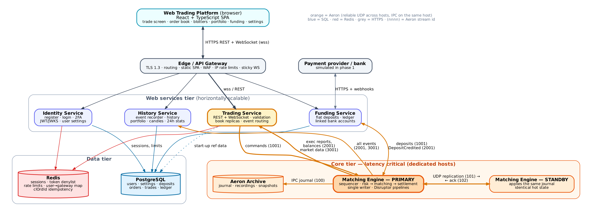

# Flash Exchange — Detailed Design

Status: **Draft v0.1 (design only, no implementation)** · Scope: **Spot trading** · Date: 2026-11-03

Flash Exchange is a spot currency exchange. Registered users fund their accounts from fiat, place **limit** and **market** orders (Good-Till-Cancel by default), see a live order book, blotters and portfolio, and cancel orders. The core is a low-latency **Java matching engine**; all backend messaging is **Aeron** (IPC on-box, reliable UDP across boxes) and in-process concurrency uses the **LMAX Disruptor**.

## Document map

| # | Document | What it covers |
|---|----------|----------------|
| 1 | [Architecture](docs/01-architecture.md) | System context, component diagram, deployment topology, tech stack, key decisions (ADRs) |
| 2 | [Matching Engine](docs/02-matching-engine.md) | Order book data structures, matching rules, order types/TIF, Disruptor pipeline, risk, determinism, recovery |
| 3 | [Messaging & Protocol](docs/03-messaging-protocol.md) | Aeron channels/stream IDs, SBE message catalogue, sequencing & gap recovery |
| 4 | [Trading Service](docs/04-trading-service.md) | Order gateway, validation, session routing, market-data fan-out, WebSocket protocol |
| 5 | [Web Platform](docs/05-web-platform.md) | UI features, layout, state management, settings, auth flows |
| 6 | [Accounts, Funding & Data](docs/06-accounts-funding-data.md) | Ledger, deposits, balances/holds, PostgreSQL schema, persistence pipeline |
| 7 | [Interactions](docs/07-interactions.md) | Sequence diagrams for every key flow, order state machine |
| 8 | [NFRs, Operations & Roadmap](docs/08-nfr-ops-roadmap.md) | Latency/throughput targets, HA, security, observability, testing, delivery plan |

The whole design in one file: [design.pdf](design.pdf) or [design.html](design.html) (open in a browser; light/dark toggle).

Architecture diagrams are Graphviz (sources in `docs/diagrams/*.dot`, rendered to PNG and SVG). Flow and sequence diagrams are Mermaid and render in GitHub, GitLab, VS Code and IntelliJ.

## Code

| Module | Contents |
|---|---|
| [`protocol/`](protocol) | Binary message flyweights shared by the engine and its clients |
| [`matching-engine/`](matching-engine) | Matching engine, Disruptor pipeline, Aeron IPC / UDP transport and client ([README](matching-engine/README.md)) |

Build with JDK 21+ and Maven 3.9+: `mvn verify` runs the unit and Aeron integration tests and the coverage check.

## Executive summary

**Components** (by tier: Client → Edge → Web services → Core, plus Data)

1. **Matching Engine** (Java; PRIMARY + hot STANDBY) — owns order books *and* the authoritative trading balances (pre-trade funds hold + post-trade settlement) in one deterministic, single-writer state machine. Five internal layers: transport & sequencing → inbound Disruptor (journal ‖ replicate ‖ risk-hold → match → settle ‖ market data) → release gate & egress → in-memory state → control plane. Journal recorded in Aeron Archive (100), replicated to standby (101/102), snapshots; arbiter-driven failover with epoch fencing.
2. **Trading Service** (Java) — bridge between web and engine. Authenticates sessions, validates orders (static + soft balance check), forwards SBE commands over Aeron, routes acks/execution reports to the owning user, and fans out L2 order books / trades to browsers over WebSockets (snapshot + sequenced deltas, conflated).
3. **Identity Service** (Spring Boot) — registration, login, email verification, 2FA, JWT/refresh tokens, user settings (theme, colour scheme, defaults).
4. **Funding Service** (Spring Boot) — fiat deposits (payment-provider adapter, mocked in phase 1), double-entry ledger, sends `Deposit` commands to the Matching Engine to credit trading balances.
5. **History Service** (Java) — event recorder: subscribes to 2001/3001 (gaps filled from Archive replay 4001), writes orders/trades/balances history to PostgreSQL, serves history REST queries (trades blotter, order history, portfolio valuation, candles).
6. **Edge / API Gateway** (Envoy or Nginx) — TLS, WAF, routing, IP rate limits, sticky WebSockets, serves the SPA.
7. **Data tier** — **PostgreSQL** (users, ledger, history; a projection, not the source of truth) and **Redis** (sessions, token denylist, distributed rate limits, clOrdId idempotency, user→gateway map; never on the matching path).
8. **Web Platform** (React + TypeScript SPA) — responsive trading UI: order entry, live order book with own-order highlighting, open-orders & trades blotters, portfolio, deposits, settings, dark/light themes.

**Key design decisions**

- Fixed-point `long` prices/quantities everywhere; zero allocation on the hot path; SBE encoding; Agrona collections; object pools.
- **Single-writer per state**: one matching thread per instrument shard, one risk thread per user shard; no locks on the hot path.
- **Risk inside the Matching Engine** (not in Trading Service) so that funds holds and fills are serialised in one log — no double-spend races, no reconciliation loops. Trading Service still does a fast *soft* check for UX.
- **Determinism**: time is stamped once at sequencing and journaled, never read in business logic → exact replay, hot standby and audit.
- **Release gate**: no event leaves the engine until its command is journaled and acked by the standby → RPO 0.
- **Layered tiers**: Client → Edge → Web services → Core, with a Data tier (PostgreSQL + Redis) kept off the hot path.
- **Market orders** are IOC with a price-protection collar (default ±5% of best opposite) — never rest on the book.
- **TIF**: GTC (default, preselected), IOC, FOK; GTD reserved in the schema for later.
- **Market data to browsers**: L2 aggregated levels (price, total qty, order count), snapshot + sequenced incremental deltas, conflated to ≤ 20 updates/s per book per client; own-order highlighting computed client-side from the user's open orders (plus optional queue-position hint from Trading Service).

**Additions to the original spec ("anything I missed")**

Withdrawals; KYC/AML tiering; fee schedule (maker/taker) and fee reporting; price chart (OHLCV candles) and 24h ticker; public trade tape; self-trade prevention; post-only flag; price bands / circuit breakers and instrument halt; instrument reference data (tick size, lot size, min notional); idempotent client order IDs; cancel-all; rate limiting; 2FA, session/device management; audit log; admin/ops console (halt market, mass-cancel, user freeze); toasts/notifications for fills; CSV export of history; API keys for programmatic trading (later); reconciliation between ledger and engine balances; observability (latency histograms per hop).

**Delivery plan (summary)** — see [08](docs/08-nfr-ops-roadmap.md#86-delivery-roadmap)

| Phase | Goal |
|-------|------|
| 0 Foundations | Gradle multi-module repo, SBE schemas, Aeron media driver config, CI, test harness |
| 1 Matching Engine | Order book + matching + risk + Disruptor pipeline, single node with Archive & snapshots; JMH + latency tests |
| 2 Trading Service | Order gateway, validation, routing, market-data fan-out, WebSocket API |
| 3 Identity, Funding, History | Auth, settings, deposits/ledger, history DB and query API |
| 4 Web Platform | Full trading UI |
| 5 Production hardening | Standby engine + replication + arbiter, failover drills, perf tuning, security, observability, load tests |
| 6 Extensions | Withdrawals, KYC, API keys, admin console, GTD |

## Open questions for you

1. **Instruments** — fiat FX pairs only (EUR/USD, GBP/USD …) or crypto too? Affects decimals and custody.
2. **Fiat deposits** — real payment provider (Open Banking / Stripe / Modulr) or simulated bank for now? Design assumes a pluggable adapter, mock first.
3. **HA from day one?** — design supports a single-node engine first (Archive + snapshots), then primary/standby. Aeron Cluster (Raft) remains an option if automatic quorum is preferred over an arbiter.
4. **Hosting** — bare metal/VMs (best latency), or Kubernetes for non-latency-critical services only? Design assumes ME + Trading Service on tuned hosts, rest anywhere.
5. **Regulatory scope** — KYC level needed before trading/deposits.
