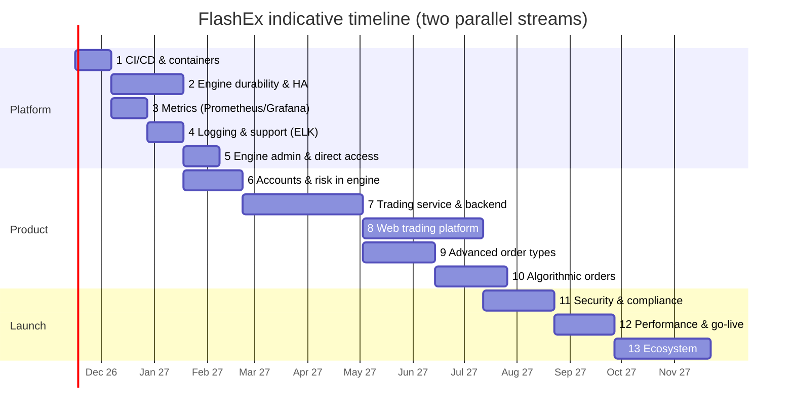

# FlashEx Roadmap

Status: **v1.0 draft** · Updated: 2026-11-04 · Scope: full spot FX exchange as specified in [`docs/`](docs/README.md)

The design describes a complete exchange: matching engine, trading service, web platform, identity, funding,
history, observability and high availability. So far only the **matching engine and its Aeron integration** exist.
This roadmap orders the remaining work so that each phase builds on the one before it and ends with something
working and testable.

## Where we are

| Area | Status |
|---|---|
| Detailed design (architecture, protocol, services, UI, NFRs) | ✅ Done (`docs/`, `design.pdf`) |
| Matching engine: price-time matching, LIMIT/MARKET, GTC/IOC/FOK, post-only, STP, collar | ✅ Done (`matching-engine/`) |
| Disruptor pipeline, Aeron IPC / reliable UDP, L2 market data, snapshots | ✅ Done |
| Protocol module (binary flyweights), engine client | ✅ Done |
| Tests: 126 unit + integration, 99.9 % line coverage | ✅ Done |
| Everything else in this document | ⏳ Planned |

## Phase overview

| # | Phase | Why it comes here | Size* | Depends on |
|---|---|---|---|---|
| 1 | **Delivery foundations: CI/CD and containerisation** | Every later phase ships as containers through a pipeline | M | – |
| 2 | **Engine durability and HA**: journal, snapshots, standby | Nothing real can run on an engine that forgets its state on restart | L | 1 |
| 3 | **Observability I: metrics** (Prometheus, Grafana) | We need to see latency and throughput before adding load and services | M | 1, 2 |
| 4 | **Observability II: logging and support** (ELK, Kibana) | The support desk must be able to answer "what happened to my order?" from day one of trading | M | 1, 3 |
| 5 | **Engine admin and direct access**: book inspection, admin ops | Operators need to look inside and act on the engine without the trading service | M | 2, 3, 4 |
| 6 | **Accounts and risk in the engine**: balances, holds, settlement | The trading service and UI need funds checks and positions | L | 2 |
| 7 | **Trading Service and backend services** (Docker, tests) | The bridge between users and the engine | XL | 1–6 |
| 8 | **Web trading platform** | The user-facing product | XL | 7 |
| 9 | **Advanced order types**: stop, stop-limit, OCO, GTD, amend, trailing | Richer trading once the core flow works end to end | L | 6, 7 (8 for UI) |
| 10 | **Algorithmic orders**: iceberg, peg, TWAP, VWAP, POV and more | Builds on advanced order infrastructure | L | 9 |
| 11 | **Security, compliance and surveillance** | Required before real money | L | 7, 8 (can start in parallel with 9) |
| 12 | **Performance, resilience and go-live readiness** | Prove the NFRs, then launch | L | all of the above |
| 13 | **Ecosystem**: public API, FIX, mobile, market makers | Growth after launch | L | 12 |

\*Size (one small team): **M** ≈ 2–4 weeks, **L** ≈ 4–8 weeks, **XL** ≈ 8–12 weeks. Phases 3/4, 9/11 and parts of
7/8 can run in parallel with a second stream of work.

---

## Phase 1: Delivery foundations (CI/CD and containerisation)

**Goal:** every component builds, tests and ships as a container image from a pipeline. A developer can start the
whole stack with one command.

- **Build quality:** Maven wrapper, Checkstyle/Spotless formatting, SpotBugs, dependency and vulnerability scanning (OWASP / Dependabot), JaCoCo gate (already in place).
- **CI pipeline** (GitHub Actions): build → unit tests → Aeron integration tests → coverage → image build → push to registry. Run nightly JMH benchmarks and keep a history of the results.
- **Containers:**
  - Multi-stage Dockerfiles on JDK 21 (Temurin) with distroless or slim runtime images and a non-root user.
  - **Matching engine** image. The Aeron directory lives on `/dev/shm`, so give the container enough `--shm-size`; set `ulimit` and the JVM flags (`--add-exports`).
  - **Standalone Aeron Media Driver** image, shared over IPC by co-located containers through a shared `/dev/shm` volume, or with `ipc: shareable` / host IPC.
  - Network modes: bridge for development; host networking for UDP performance tests.
- **docker-compose** dev stack: media driver, engine, (later) trading service, PostgreSQL, Redis, Prometheus, Grafana, ELK. Profiles: `core`, `full`, `observability`.
- **Kubernetes readiness** for the stateless services: Helm charts or Kustomize. The latency-critical core stays on tuned hosts or VMs (see design ADR).
- **Versioning and releases:** semantic versions, changelog, image tags tied to git SHAs.

**Exit criteria:** `docker compose up` runs the engine with a demo client; every merge to `main` produces tested images.

## Phase 2: Engine durability and high availability

**Goal:** no acknowledged order or trade is ever lost, and the engine survives a host failure (design §2.8–2.9).

- **Command journal** on Aeron Archive (stream 100); every command is recorded before any of its output is released.
- **Snapshots** taken through a barrier command (books, ID counters, `bookSequence`), stored in the Archive. Cold recovery = snapshot + journal replay. Determinism tests prove that replay produces byte-identical output.
- **Primary/standby replication** (streams 101/102), with a **release gate** in SYNC mode (output only after the standby acks) and ASYNC fallback.
- **Arbiter/witness** with epoch fencing; automatic failover; client resend by `clOrdId` with engine-side deduplication.
- **Duplicate `clOrdId` detection** per user, so a resend after failover is safe.
- **Rolling upgrades** (upgrade standby → switch over → upgrade old primary); schema versioning rules for the protocol.
- **Chaos tests:** kill the primary mid-burst, drop packets on the replication link, fill the disk.

**Exit criteria:** primary killed under load, standby promoted in < 1 s, zero lost or duplicated fills (verified by reconciliation).

## Phase 3: Observability I: comprehensive metrics (Prometheus and Grafana)

**Goal:** latency, throughput and health of every component are visible in real time.

- **Engine metrics** collected off the hot path: Agrona counters and HdrHistograms written by the engine threads, read and exported by a separate **metrics agent** thread.
  - Per-stage latency (ingress → match → publish), commands/s by type, rejects by reason, trades/s, volume per instrument.
  - Ring buffer remaining capacity, order pool usage, book depth and resting order count per instrument.
  - Publisher drops (not connected / back-pressured), journal and replication lag, snapshot duration.
- **Aeron metrics** from the driver's CnC counters: NAKs, retransmits, back-pressure events, receiver/sender positions, errors from the driver error log.
- **JVM metrics** (Micrometer): GC, heap, threads, safepoints. Host metrics through node-exporter.
- **Prometheus** scrape configs, recording rules and **alert rules**:
  - latency SLO breach;
  - ring buffer more than 50% full;
  - replication lag;
  - publisher drops;
  - failover events;
  - error rates.
- **Grafana dashboards** provisioned as code:
  - Engine Overview;
  - Latency Heatmaps;
  - Aeron Transport;
  - Market Activity per instrument;
  - JVM/Host;
  - Business KPIs (orders, users, volume).
- Later phases add trading service, web and database metrics to the same stack (OpenTelemetry for the request paths).

**Exit criteria:** dashboards in the compose stack; alerts fire in a chaos drill; a load test's latency profile is visible end to end.

## Phase 4: Observability II: logging review and log search for the support desk (ELK / Kibana)

**Goal:** a support agent can answer "where is my order / why was it rejected / why did it fill at that price" in
under a minute, without asking an engineer.

- **Logging review and standards:**
  - Structured JSON logs, using SLF4J + Logback with a JSON encoder (replacing `System.Logger`).
  - Consistent fields: `service`, `instrument`, `userId`, `orderId`, `clOrdId`, `engineSeq`, `tradeId`, `correlationId`.
  - Asynchronous, garbage-free appenders. The matching hot path never logs; it emits events.
- **Order audit trail:** a dedicated **audit/event logger** service subscribes to streams 2001/3001 (and later the journal) and writes one human-readable, searchable record per order lifecycle event and per trade. This is the support desk's single source of truth.
- **Pipeline:** Filebeat/Fluent Bit → Logstash or ingest pipelines → **Elasticsearch** → **Kibana**. Index lifecycle (hot/warm/delete), retention aligned with regulatory requirements.
- **Kibana for support:**
  - Saved searches: *order lifecycle by clOrdId/orderId*, *all activity for a user*, *rejects by reason*, *cancels and STP events*, *trades by instrument and time*.
  - Support dashboard with reject reasons over time, top users by rejects, and error spikes.
  - Role-based access (support desk = read-only, PII masking).
- **Runbooks** linked from alerts and dashboards (common customer questions, failover, stuck orders).

**Exit criteria:** given only a client order id, a support agent finds the full lifecycle (accepted → fills → cancel/reject reason) in Kibana.

## Phase 5: Engine admin and direct access

**Goal:** operators can inspect and control the engine directly, independently of the trading service, safely and
with an audit trail.

- **Admin command stream** (new stream, e.g. 1101) with authenticated, signed admin commands, journaled like every other command so that admin actions are deterministic and replayable:
  - halt/resume an instrument;
  - cancel-all for an instrument;
  - cancel all of a user's orders;
  - suspend/unsuspend a user;
  - add an instrument or change its parameters (tick, lot, collar, bands);
  - force a snapshot;
  - change the log level.
- **Direct read access:**
  - full **L3 order book** (every order with its queue position);
  - order lookup by `orderId` / `clOrdId` / user;
  - per-user open orders;
  - engine statistics.
  - Served by a **query/replica agent** that rebuilds state from the event stream (or runs on the standby), so reads never touch the matching threads.
- **Admin tools:** `flashex-admin` CLI (Aeron client) and later an **admin console** in the back-office UI (Phase 8/11), with maker-checker approval for destructive operations.
- **Audit:** every admin action is recorded with operator, reason and before/after state, and is searchable in Kibana.

**Exit criteria:** an operator halts EURUSD, inspects the L3 book, cancels one user's orders and resumes, all audited, with no trading service involved.

## Phase 6: Accounts and risk in the engine

**Goal:** funds are checked and moved atomically with matching (design ADR-002).

- Per-user, per-currency **balances**: available, held and pending withdrawal, partitioned into risk shards.
- **Pre-trade holds** (limit at price × qty × (1+fee); market at the collar price; sell = base qty), with release on cancel or remainder.
- **Post-trade settlement** of buyer and seller, **maker/taker fees**, and a fee account. New `BalanceUpdate` / `DepositCredited` events.
- **Deposit / withdraw** commands (idempotent on `fundingTxId`).
- Reconciliation invariant checked continuously: Σ balances = Σ deposits − Σ withdrawals.
- **Price bands / circuit breakers:** reject orders outside ±X% of the reference price and auto-halt on extreme moves.
- Randomised tests extended to conservation of funds.

**Exit criteria:** randomised test of 1 M commands with deposits, trades and cancels keeps the funds invariant; insufficient-funds rejects are correct.

## Phase 7: Trading Service and backend services (fully containerised and tested)

**Goal:** the complete backend from the design runs in Docker with unit and integration tests.

- **Trading Service** (Netty, Disruptor, Aeron):
  - WebSocket and REST APIs; JWT session authentication.
  - Validation, rate limiting and idempotency (Redis), soft funds check.
  - Command encoding, then routing of private events back to the user's sessions.
  - L2 book replicas with gap recovery and conflation (≤ 20 Hz).
  - Own-order queue position; ticker and recent trades.
- **Identity Service:** registration, email verification, login, 2FA (TOTP), refresh tokens, sessions/devices, user settings (theme, colour scheme, defaults).
- **Funding Service:** fiat deposits through a **mock payment provider**, double-entry ledger, `Deposit` commands, reconciliation job.
- **History Service:** records events into PostgreSQL; serves order and trade history, portfolio valuation, **OHLCV candles** (1m–1d) and 24h stats; CSV export.
- **Edge / API gateway** (Envoy/Nginx): TLS, routing, WAF basics, sticky WebSockets.
- **Data stores:** PostgreSQL (Flyway migrations), Redis.
- **Tests:**
  - unit tests per service;
  - **Testcontainers** integration tests (PostgreSQL, Redis, real engine + media driver);
  - contract tests for the WS/REST API (OpenAPI / AsyncAPI specs);
  - end-to-end tests with simulated trader bots in docker-compose;
  - coverage gates as for the engine.
- **docker-compose `full` profile:** edge, identity, funding, history, trading service, media driver, engine, PostgreSQL, Redis and the observability stack.

**Exit criteria:** a scripted user registers, deposits, places/cancels orders and sees fills and history entirely through the public APIs, in containers, in CI.

## Phase 8: Web trading platform

**Goal:** the modern, responsive trading UI from the spec (see `mockups/` for the target look).

- **Onboarding:** registration, email verification, login, 2FA, password reset, session/device management.
- **Settings:** light/dark/system theme, colour scheme (incl. colour-blind and red-up/green-down), default pair, order type and TIF (GTC preselected), confirmations, layout persistence.
- **Funding:** deposit fiat (mock PSP), deposit history, balances.
- **Trade screen:**
  - pair selector with 24h ticker;
  - **price chart** (candles, line/area, volume, MA/EMA, Bollinger; 1m–1d) and **depth chart**;
  - **order book** with bid/ask side by side, per-level total, cumulative depth bars and **own-order highlight**;
  - order entry (limit/market, TIF, post-only, % of balance, fee estimate, confirmation);
  - recent trades.
- **Blotters:** open orders (live, partial fills, cancel and cancel-all), order history, trades/fills, portfolio (balances, holdings, valuation, allocation, P&L); filters and CSV export.
- **Real-time:** WebSocket client in a Web Worker, sequence-gap recovery, reconnect with backoff, connection status, toast notifications for fills.
- **Quality:** responsive (desktop, tablet, mobile), WCAG 2.1 AA, Playwright end-to-end tests, visual regression tests, Lighthouse ≥ 90; served from a container behind the edge.

**Exit criteria:** a user runs the full journey in the browser (register → deposit → trade → cancel → review blotters) in light and dark themes on desktop and mobile.

## Phase 9: Advanced order types

**Goal:** professional order types. Note: **IOC and FOK are already in the engine**; this phase exposes them end
to end and adds conditional orders.

| Order type | Behaviour | Where |
|---|---|---|
| IOC / FOK | Already in the engine; expose in API and UI | Engine ✅, TS, UI |
| **GTD** | Good till date/time; expiry driven by journaled timer commands | Engine |
| **Stop (stop-loss market)** | Becomes a market order when the last trade price crosses the trigger | Engine (trigger book) |
| **Stop-limit** | Becomes a limit order when triggered | Engine |
| **Take-profit / take-profit-limit** | Mirror of stop on the profit side | Engine |
| **OCO (one-cancels-other)** | Linked pair (e.g. take-profit + stop-loss); a fill or trigger of one cancels the other | Engine (order lists) |
| **Bracket / OTO** | Entry order that on fill places a linked OCO exit pair | Engine |
| **Trailing stop** | Trigger follows the market by a fixed offset or percentage | Engine |
| **Amend (cancel/replace)** | Change price/qty; keeps priority on a qty decrease, loses it on a price change or qty increase | Engine |
| **Reduce-only / max-show** | Margin-era flags, reserved | – |

- The engine keeps a per-instrument **trigger book** (stop orders sorted by trigger price) that is evaluated after each trade, deterministically within the same command.
- The holds model is extended for conditional orders (hold at activation or at placement; configurable).
- The UI gets order entry tabs for Stop/OCO/Trailing and shows conditional orders in the blotter.

**Exit criteria:** randomised plus scenario tests for trigger cascades (one trade triggering several stops), OCO race conditions and GTD expiry across failover.

## Phase 10: Algorithmic orders

**Goal:** execution algorithms for larger traders. Simple native types run **in the engine**. Time- or
volume-scheduled algos run in a separate **Algo Engine** service that sends child orders through the normal
command path, so the matching engine stays simple and fast.

| Algo | Description | Where |
|---|---|---|
| **Iceberg** | Shows only a visible slice; refills from the hidden quantity with new time priority on each refresh | Engine (native) |
| **Pegged (primary / mid / market peg)** | Price follows the best bid/ask or the mid, optionally with an offset; re-prices on book changes ("sliding") | Engine (native) |
| **Sliding / auto-reprice post-only** | Post-only that slides to the best non-crossing price instead of being rejected | Engine (native) |
| **TWAP** | Splits the parent order evenly over a time window | Algo Engine |
| **VWAP** | Follows a historical or live volume curve | Algo Engine |
| **POV (participation)** | Targets X% of market volume | Algo Engine |
| **Implementation shortfall / arrival price** | Balances urgency against market impact | Algo Engine |
| **Sniper / liquidity seeking** | Waits and takes liquidity when it appears at or better than a limit | Algo Engine |
| **Randomised iceberg** | Iceberg with randomised slice sizes and timing | Engine + Algo |

- Parent/child order model, algo state persistence and recovery, kill switch, per-user algo limits.
- **Back-testing harness** against recorded market data (from the journal) and a **market simulator** for tests.
- UI: algo order ticket, parent/child view in the blotter, progress bars.

**Exit criteria:** each algo validated in the simulator and on the test environment with recorded flow; the kill switch cancels all child orders within one second.

## Phase 11: Security, compliance and market integrity

- **Identity hardening:** 2FA enforcement policies, device binding, brute-force protection, account recovery flows.
- **KYC/AML:** tiered verification with a provider integration, sanctions screening, limits by tier, transaction monitoring.
- **Withdrawals:** verified bank accounts, approval workflows, velocity limits.
- **Market surveillance:** detection of wash trading, spoofing/layering, marking the close and momentum ignition; alerts to compliance.
- **Back-office / admin console:** user management, instrument management, fee schedules, manual adjustments with maker-checker, reports.
- **Security engineering:** threat model, secrets in Vault/KMS, TLS everywhere, network policies, container image signing (cosign) and SBOMs, penetration test, OWASP ASVS L2 review, bug bounty readiness.
- **Regulatory reporting** and statements: trade reports, monthly statements, tax exports. Data retention and GDPR (export/erasure with financial-record exceptions).

## Phase 12: Performance, resilience and go-live

- **Load and soak tests:** simulated traders at 2× the expected peak for 24 h; coordinated-omission-safe latency measurement end to end (browser → engine → browser).
- **Engine tuning:**
  - thread affinity and core isolation;
  - busy-spin wait strategies;
  - kernel-bypass evaluation (e.g. ef_vi / Onload);
  - GC verification (zero allocation on the hot path, checked with Epsilon GC).
- **Chaos and DR:** failover drills, region/datacentre DR with archive replication, backup/restore of PostgreSQL, game days.
- **Environments:** dev → test → staging (production-like) → production; infrastructure as code (Terraform / Ansible); blue/green for the stateless services.
- **Operational readiness:** SLOs and error budgets, on-call rota, runbooks, incident process, status page.
- **Launch:** closed beta with invited users and market makers, then public launch.

## Phase 13: Ecosystem and growth (post-launch)

- **Public trading API:** REST and WebSocket with API keys and scopes, docs portal, sandbox environment, SDKs (Python, TypeScript, Java).
- **FIX 4.4 gateway** for institutional clients, plus a **drop-copy** service.
- **Market data products:** public L2/L3 feeds, historical data downloads, candles API.
- **Market maker programme:** fee tiers, rebates, maker obligations monitoring.
- **More instruments:** additional FX pairs and crosses, and potentially crypto/fiat pairs (requires custody).
- **Mobile apps** (React Native) and push notifications.
- **Analytics:** user P&L analytics, trade cost analysis (TCA) for algo users.
- **Later product lines** (out of current scope): margin trading, perpetuals/forwards, lending.

---

## Cross-cutting work (runs through every phase)

| Topic | Practice |
|---|---|
| Testing | Unit + randomised/property + integration (Testcontainers / real Aeron) + E2E; coverage gates; determinism tests for the engine |
| Performance | JMH benchmarks tracked in CI; latency budgets per hop; regressions fail the build |
| Documentation | Design docs updated per phase; ADRs for every significant decision; API specs (OpenAPI/AsyncAPI) |
| Security | Dependency scanning, secret scanning, least privilege, security review per phase |
| Observability | Every new component ships with metrics, structured logs and a dashboard |
| Data | Schema migrations (Flyway), protocol versioning rules, backward-compatible events |

## Mockups

Target look of the web platform (Phase 8): see [`mockups/`](mockups/).

| Screen | Light | Dark |
|---|---|---|
| Trade screen (GBP/USD) | `mockups/trade-light.png` | `mockups/trade-dark.png` |
| Full chart: candlesticks with volume and moving averages | `mockups/chart-candles-light.png` | `mockups/chart-candles-dark.png` |
| Full chart: area/line with depth chart | `mockups/chart-area-light.png` | `mockups/chart-area-dark.png` |
