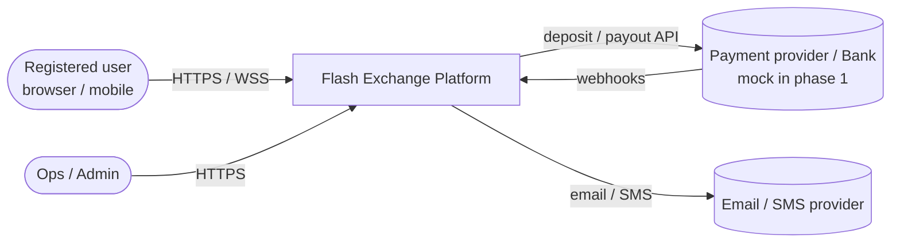
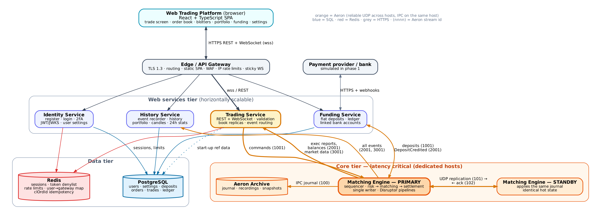
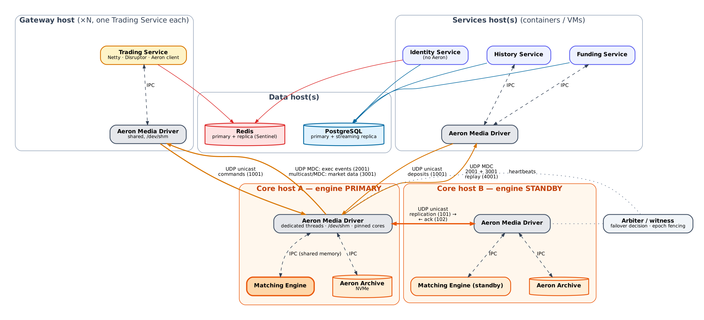

# 1. Architecture

## 1.1 System context



## 1.2 Layered component view



The platform is organised in five tiers. Each tier talks only to the tier next to it or to the data tier. The one exception is the Aeron link between the web services tier and the core tier.

| Tier | Components | Character |
|---|---|---|
| **Client** | Web Trading Platform (React SPA) | Untrusted; HTTPS + WSS only |
| **Edge** | Edge / API Gateway (Envoy or Nginx) | TLS termination, WAF, routing, IP rate limits, sticky WebSocket routing, serves the SPA bundle |
| **Web services** | Identity, History, Funding, Trading Service | Horizontally scalable; stateless apart from caches; Spring Boot (Identity, Funding, History REST) and Netty (Trading Service) |
| **Core** | Matching Engine PRIMARY, Matching Engine STANDBY, Aeron Archive | Latency critical; dedicated, tuned hosts; deterministic single-writer state machine |
| **Data** | PostgreSQL, Redis | Durable projections and shared caches. **Never on the matching hot path** |

Colour legend used in all diagrams: **orange = Aeron** (IPC on the same host, reliable UDP across hosts), **blue = SQL**, **red = Redis**, **grey = HTTPS**. Numbers in brackets are **Aeron stream IDs** (see [§3.1](03-messaging-protocol.md#31-aeron-stream-and-channel-plan)).

### Component responsibilities

| Component | Responsibilities | Owns state | Tech |
|---|---|---|---|
| **Matching Engine (primary)** | Sequences every command; journals; replicates to the standby; pre-trade risk (funds hold); price-time matching; settlement; exec reports; L2 market data; snapshots | Authoritative: order books, open orders, trading balances, sequence counters | Java 21, Aeron (driver, Archive), Disruptor 4, Agrona, SBE |
| **Matching Engine (standby)** | Consumes the replicated journal and applies it with the same code, so its state stays identical; acks; takes over on failover | Mirror of primary | same binary, `role=STANDBY` |
| **Aeron Archive** | Records the command journal (100) and the output streams; stores snapshots; serves replays (4001) | Journal and snapshots on NVMe | Aeron Archive |
| **Trading Service** | WS/REST for trading; JWT session auth; validation; idempotency; rate limiting; soft funds check; command encoding; event routing to users; L2 book replicas; conflated fan-out | Soft state only (rebuildable) | Java 21, Netty, Disruptor, Aeron client |
| **Identity Service** | Registration, email verification, login, 2FA, JWT/JWKS, refresh tokens, sessions/devices, user settings | PostgreSQL + Redis | Spring Boot 3, Spring Security |
| **Funding Service** | Fiat deposits through a PSP adapter (mock first), linked bank accounts, double-entry ledger, `Deposit` commands to the engine, reconciliation | PostgreSQL | Spring Boot 3, Aeron client |
| **History Service** | Event recorder: subscribes to 2001/3001 and fills gaps by Archive replay (4001); writes orders, fills, balances and candles to PostgreSQL; REST for history, portfolio, candles, 24h stats, CSV export | PostgreSQL (projection) | Java 21, Aeron client, JDBC batch/COPY, Spring Web |
| **Edge / API Gateway** | TLS 1.3, routing, WAF, IP rate limits, static SPA, sticky WS | none | Envoy / Nginx |
| **PostgreSQL** | Users, settings, ledger, deposits, order and trade history, candles | — | PostgreSQL 16 (+ streaming replica) |
| **Redis** | Shared, non-authoritative, fast state for the web services tier (see §1.5) | — | Redis 7 (primary + replica, Sentinel) |

## 1.3 Deployment topology



Rules:

- **Same host → Aeron IPC.** Every host runs **one Aeron Media Driver**. Processes on the host exchange messages through its shared-memory log buffers in `/dev/shm`.
- **Across hosts → Aeron reliable UDP.** Use unicast for commands (1001) and replication (101/102). Use **MDC (multi-destination-cast) or multicast** for exec events (2001) and market data (3001), so one send from the engine reaches every gateway and service.
- **Core hosts** use the Media Driver in `DEDICATED` threading mode with busy-spin idle strategies. Hot threads are pinned to isolated cores (`isolcpus`), the Archive writes to local NVMe, and A and B have a direct, low-jitter network path (same rack and switch, 10/25 GbE).
- **Arbiter / witness**: a small process on a third host that watches heartbeats from both engines. It promotes the standby only when the primary is unreachable from both the witness and the standby. A monotonically increasing **epoch** fences off a stale primary, which prevents split-brain.
- **Gateway hosts**: one Trading Service per host, or a few with separate core pinning. Scale horizontally behind the Edge with sticky WebSocket sessions.
- **Services and data hosts** have no latency requirements and can run on VMs or Kubernetes.

## 1.4 Technology stack

| Concern | Choice | Why |
|---|---|---|
| Language/runtime | Java 21 LTS; hot path allocation-free; ZGC (generational) elsewhere | Mature low-latency ecosystem |
| Messaging | Aeron (Media Driver, Archive); Aeron Cluster as an optional later upgrade (ADR-001) | Required; µs latency, reliable UDP, replay |
| Encoding | SBE (Simple Binary Encoding) | Zero-copy flyweights |
| Inter-thread | LMAX Disruptor 4.x | Required; batching, single writer |
| Collections/buffers | Agrona (`Long2ObjectHashMap`, `UnsafeBuffer`, `IdleStrategy`, counters) | Primitive, allocation-free |
| Thread affinity | OpenHFT Java-Thread-Affinity | Pin hot threads |
| Gateway | Netty 4 | Fine-grained control, low GC |
| Services | Spring Boot 3 | Productivity |
| DB | PostgreSQL 16 | Ledger integrity, rich queries |
| Cache / shared state | Redis 7 (Lettuce client) | Sessions, distributed limits, idempotency |
| Frontend | React 18, TypeScript, Vite, Tailwind + Radix/shadcn, Zustand, TanStack Query/Table, react-virtuoso, lightweight-charts | Modern, fast, accessible |
| Build | Gradle (Kotlin DSL) multi-module; pnpm | |
| Observability | Micrometer, Prometheus, Grafana, HdrHistogram, OpenTelemetry (non-hot paths), Loki | |
| Testing | JUnit 5, jqwik, JMH, Testcontainers, Playwright | |

## 1.5 Redis usage (kept off the hot path)

| Key space | Used by | Purpose | TTL |
|---|---|---|---|
| `sess:{sessionId}` | Identity, Trading Service | Session metadata, device, last seen | refresh-token lifetime |
| `deny:{jti}` | Identity, Trading Service | Revoked access/refresh tokens (logout, password change) | token expiry |
| `rl:{userId}:{bucket}` | Trading Service, Edge | Global per-user rate limits across instances, using Lua token bucket. Local buckets enforce in-process, and Redis is synced asynchronously every 100 ms | 1–60 s |
| `clord:{userId}:{clOrdId}` | Trading Service | Cross-instance idempotency for client order IDs (SETNX). The engine remains the final duplicate check | 24 h |
| `gw:{userId}` | Trading Service | Which gateway instances currently host a user's sessions (diagnostics and targeted kick-out) | session |
| `ticker:{symbol}` | History Service | Cached 24h stats for REST | 5 s |
| `login:fail:{email/ip}` | Identity | Brute-force protection | 15 min |

If Redis is unavailable, the services fall back gracefully: local rate limits only, a local idempotency cache, and the JWT signature check (the denylist check fails open only for access tokens younger than 60 s). Trading continues.

## 1.6 Architecture Decision Records (summary)

| ADR | Decision | Alternatives considered | Rationale |
|---|---|---|---|
| 001 | **Primary/standby engines with a replicated journal** over Aeron (101/102), arbiter-based failover with epoch fencing. Aeron Cluster (3-node Raft) kept as an upgrade path | Aeron Cluster from day one; single node only | Lowest and most predictable latency (one RTT to the standby), simple to reason about, matches the desired topology. Raft adds automatic quorum at the cost of an extra node and some latency |
| 002 | **Trading balances and funds holds live in the Matching Engine** | Risk in Trading Service | Holds and fills serialised in one log: no double-spend, no distributed consistency problem |
| 003 | Fixed-point `long` price/qty, per-instrument scale | `BigDecimal`, `double` | No allocation, exact |
| 004 | Engine Disruptor pipeline: *journal ‖ replicate ‖ risk-hold → match → settle ‖ market data → release gate → publish* | Single thread | Parallel durability with processing; deterministic; one writer per shard |
| 005 | **Output release gate**: no event leaves the engine until its command is journaled locally *and* acked by the standby (sync mode) | Publish before durable | Clients never see a fill that could be lost on failover (RPO = 0) |
| 006 | Market orders = IOC with protection collar | Unbounded | Prevents sweeping thin books, bounds funds hold |
| 007 | Browser market data = L2 snapshot + sequenced, conflated deltas | Full book every tick | Bandwidth; still full depth with per-level liquidity |
| 008 | PostgreSQL is a **projection**; Redis is a **cache**; neither is authoritative for trading state | DB-first | Keeps storage off the hot path; rebuildable from the journal |
| 009 | Browser protocol JSON v1, binary later | Binary first | Debuggability |

## 1.7 Proposed repository layout

```
flash-exchange/
├─ docs/                         ← this design (+ diagrams/ sources)
├─ build-logic/                  ← Gradle conventions
├─ protocol/                     ← SBE XML schemas + generated codecs
├─ common/                       ← fixed-point math, ids, clocks, Aeron/Disruptor helpers
├─ matching-engine/              ← sequencer, risk, order books, matching, HA, snapshots
├─ matching-engine-bench/        ← JMH + latency harness
├─ arbiter/                      ← failover witness
├─ trading-service/              ← Netty WS/REST gateway, Aeron client, fan-out
├─ identity-service/
├─ funding-service/
├─ history-service/              ← event recorder + REST
├─ web/                          ← React SPA
├─ infra/                        ← docker-compose (dev), Ansible/Terraform, media-driver configs
└─ test-system/                  ← end-to-end & load tests (simulated traders)
```
