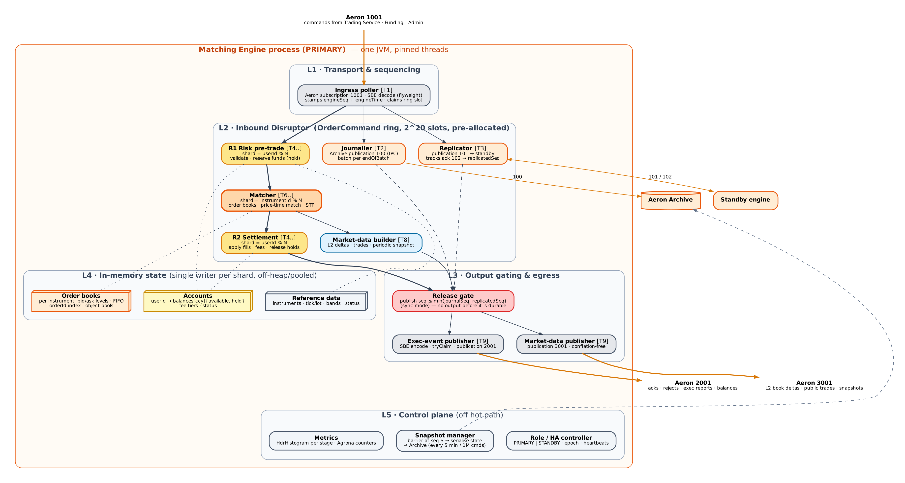
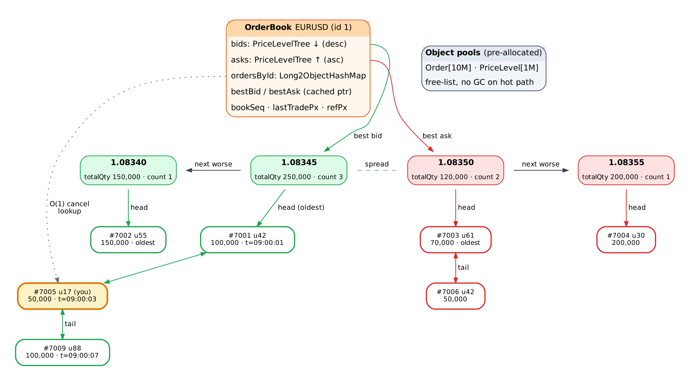
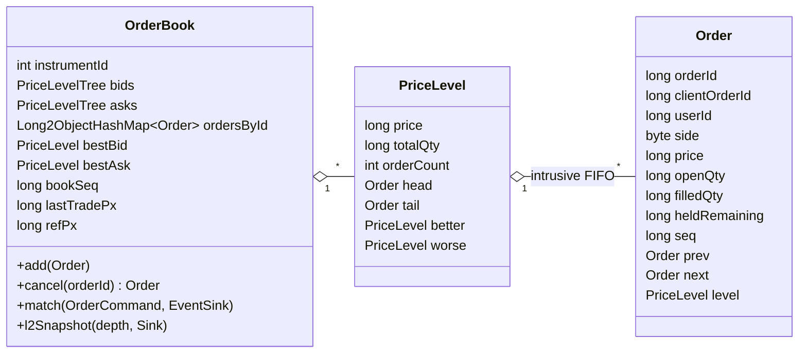
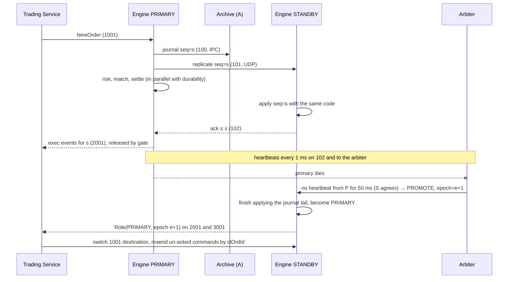

# 2. Matching Engine

## 2.1 Goals

- Price-time (FIFO) priority matching for spot instruments.
- Limit orders (GTC default, IOC, FOK, post-only), market orders (IOC with price collar), cancel, cancel-all.
- **Predictable latency**: engine-internal p99 ≤ 10 µs and p99.9 ≤ 50 µs, excluding the standby round trip. No GC pauses on the hot path.
- Throughput: ≥ 1 M commands/s per engine across all instruments; ≥ 300 k/s on one hot instrument.
- **Deterministic and event-sourced**: the same journal always produces the same state and outputs. This is what makes hot standby, replay and audit possible.
- **RPO = 0** for acknowledged events (release gate, §2.8). Failover RTO < 1 s.

## 2.2 Layered internal architecture



| Layer | Responsibility | Threads (default core map) |
|---|---|---|
| **L1 Transport & sequencing** | Poll Aeron subscription **1001**, decode SBE with flyweights, assign `engineSeq` (monotonic) and `engineTime` (the primary's clock, read once per command), copy into a pre-allocated ring slot | T1 ingress poller (core 2) |
| **L2 Inbound Disruptor** | `OrderCommand` ring, 2^20 slots. Parallel consumers: **Journaller** (Archive, stream 100), **Replicator** (stream 101 to the standby, consumes acks on 102), and the business chain **R1 risk → Matcher → R2 settlement**, plus the market-data builder | T2 journaller (core 3), T3 replicator (core 4), T4–T5 risk shards (cores 5–6), T6–T7 matcher shards (cores 7–8), T8 MD builder (core 9) |
| **L3 Output gating & egress** | **Release gate**: hold results until the command is durable. Then SBE-encode into publications **2001** (private events) and **3001** (market data) using `tryClaim` | T9 publisher (core 10) |
| **L4 In-memory state** | Accounts (balances, holds, fee tier), order books, reference data. Each partition has exactly one writer thread | — |
| **L5 Control plane** | Snapshot manager, role/HA controller (epoch, heartbeats), admin commands, metrics (Agrona counters read by an exporter outside the hot path) | T10 (shared, non-isolated core) |

The Media Driver on the same host uses three further isolated cores: conductor, sender and receiver.

**Why R1 and R2 are separate stages on the same threads.** Risk state is partitioned by `userId`, and matching is partitioned by `instrumentId`. One user's hold is placed by risk shard *k* before matching and released or settled by the same shard *k* after matching. Each account balance therefore has a single writer, with no locks and no CAS. This is the same structure as LMAX and exchange-core.

## 2.3 Command lifecycle (NewOrder, step by step)

| # | Stage | Action |
|---|---|---|
| 1 | Ingress poller | Reads `NewOrder` from 1001. Rejects malformed or unsupported versions immediately with a `Reject` result. Claims ring sequence *s*, copies the fields, sets `engineSeq = s`, `engineTime = now` |
| 2a | Journaller | Appends the raw command (with seq and time) to Archive publication 100. Advances `journalSeq` at end of batch |
| 2b | Replicator | Sends the same bytes on 101. The standby acks the highest contiguous seq on 102. Sets `replicatedSeq` |
| 2c | R1 risk (shard `userId % N`) | Checks user status, instrument status, static rules (tick, lot, min notional, price band) and duplicate `clientOrderId` (per-user open-order map). **Reserves funds**: BUY limit holds `price × qty × (1 + takerFee)` in quote; BUY market holds `quoteQty` or `collarPx × qty × (1 + fee)`; SELL holds `qty` of base. On failure, marks the slot `REJECTED(reason)` and later stages skip it |
| 3 | Matcher (shard `instrumentId % M`) | Matches against the book (§2.6). Appends `MatcherEvent`s (TRADE, CANCEL, ACCEPT) to the slot's pre-allocated event chain. Updates level aggregates |
| 4a | R2 settlement (shard per involved user) | For every TRADE, moves balances for the taker and maker, charges fees and releases price-improvement or unused holds. Each shard handles only the users it owns, so a trade between users on different shards is settled in two halves by two shards. Both halves are deterministic |
| 4b | MD builder | Turns level changes into `BookDelta` entries and `PublicTrade`s, keyed by `bookSeq` |
| 5 | Release gate | Waits until `s ≤ journalSeq` **and** (sync mode) `s ≤ replicatedSeq` |
| 6 | Publisher | Encodes `OrderAccepted` / `ExecutionReport`s / `BalanceUpdate`s on 2001 and `BookDelta` / `PublicTrade` on 3001, then frees the slot |

The gate does not stall the business stages. Matching for *s+1…s+k* continues while *s* waits for the ack. Only the publisher waits, so throughput is unaffected and latency rises by one standby round trip (≈ 15–30 µs on a local 25 GbE link).

## 2.4 Domain model

| Concept | Representation |
|---|---|
| Instrument | `int instrumentId`; base/quote currency IDs; `priceScale`, `qtyScale`, `tickSize`, `lotSize`, `minQty`, `maxQty`, `minNotional`, price band %, collar %, status (`PRE_OPEN`, `TRADING`, `HALTED`, `CLOSED`) |
| Price / quantity | `long` fixed-point (EUR/USD price scale 5 → 1.08345 = `108345`; qty scale 2) |
| Notional | `price × qty` computed with `Math.multiplyHigh` overflow checks and rescaled to quote scale, rounding against the user for holds and exactly for fills |
| Order ID | `long`, engine-assigned from a counter in state (deterministic) |
| Client order ID | `long` from the client (gateway maps string → 64-bit hash plus a check), unique per user among open orders |
| Account | `userId` → `balances[currencyId] {available, held}`, `feeTier`, `status`, `openOrderCount` |
| Side / type / TIF | `BUY`/`SELL`; `LIMIT`/`MARKET`; `GTC` (default), `IOC`, `FOK`, `GTD` (reserved) |
| Flags | `POST_ONLY`; STP mode (`CANCEL_NEWEST` default, `CANCEL_OLDEST`, `CANCEL_BOTH`, `DECREMENT`) |

## 2.5 Order book





| Operation | Complexity | How |
|---|---|---|
| Best bid/ask | O(1) | cached pointers |
| Add at existing level | O(1) | hash lookup price → level, append to tail |
| Add new level | O(log L) tree / O(1) ladder | pooled node insert, link `better`/`worse` |
| Cancel | O(1) | `ordersById` → unlink from FIFO → adjust aggregates → remove empty level |
| Match one fill | O(1) | head of best level |
| L2 snapshot depth *d* | O(d) | walk `worse` links |

Implementation notes: price levels sit in a pooled red-black tree keyed by `long`, plus a `Long2ObjectHashMap<price, level>` for O(1) access. A dense **price ladder** (array indexed by `(price − base)/tick`) is optional for narrow-range FX instruments. `Order` and `PriceLevel` come from **pre-allocated pools** (sized from configuration, e.g. 10 M orders), are recycled on fill or cancel, and are never garbage-collected. Matching emits **at most K events per command** into the slot's fixed-size chain (K=64). A taker that would generate more is split internally into continuation slots, which keeps slot memory bounded.

## 2.6 Matching algorithm

```
match(cmd):
  book = books[cmd.instrumentId]
  opp  = cmd.side == BUY ? book.asks : book.bids
  limit = cmd.type == MARKET ? collar(book, cmd.side) : cmd.price
  if cmd.postOnly and crosses(opp.best, limit): reject(WOULD_TAKE); return
  if cmd.tif == FOK and availableQty(opp, limit) < cmd.qty: reject(FOK_NOT_FILLED); return
  remaining = cmd.qty                          // or quote budget for market BUY-by-amount
  while remaining > 0 and opp.best != null and crosses(opp.best.price, limit):
      level = opp.best
      maker = level.head
      if maker.userId == cmd.userId: applySTP(cmd, maker); continue
      q = min(remaining, maker.openQty)        // budget-limited for quote-amount market buys
      emitTrade(taker=cmd, maker, px=level.price, qty=q)   // maker price
      maker.openQty -= q; level.totalQty -= q; remaining -= q
      if maker.openQty == 0: unlink(maker); emitMakerFilled(maker); free(maker)
      if level.orderCount == 0: removeLevel(level)
  if remaining > 0:
      if cmd.type == LIMIT and cmd.tif == GTC: rest(cmd, remaining)  -> OrderAccepted(NEW|PARTIALLY_FILLED)
      else: emitCancel(cmd, remaining, IOC_REMAINDER | MARKET_NO_LIQUIDITY)
```

Rules:

- **Price priority, then time priority.** Time is the engine sequence when the order rested, not a wall-clock time.
- **Execution price is the maker's price.** Price improvement goes to the taker, and the excess hold is released in R2.
- **Collar**: `bestOpposite × (1 ± collar%)`, default 5%, fixed at the start of matching.
- **Price band** (R1): reject limit orders outside ±band% of `refPx` (last trade, or mid if there is no trade).
- **STP** is checked per maker before filling.
- A cancel that arrives after a fill gets `CancelRejected(TOO_LATE)`.

## 2.7 Risk & accounts

| Event | Effect (single writer: risk shard owning the user) |
|---|---|
| `Deposit` | `available[ccy] += amt` (idempotent on `fundingTxId`, kept in a bounded dedup set and also in the snapshot) |
| New BUY limit | `available[quote] -= hold; held[quote] += hold`, where `hold = ceil(px × qty × (1 + takerFee))` |
| New SELL | `available[base] -= qty; held[base] += qty` |
| Fill (buyer) | `held[quote] -= px_exec × q × (1+fee_rate)`; `available[base] += q`; release price improvement `(px_limit − px_exec) × q × (1+takerFee)` |
| Fill (seller) | `held[base] -= q`; `available[quote] += px_exec × q × (1 − fee_rate)` |
| Fee | Credited to fee account `userId=0` in the received currency |
| Cancel / remainder / reject after hold | Release `order.heldRemaining` |
| `WithdrawRequest` | `available -= amt; pendingWithdrawal += amt` → `WithdrawResult` finalises or reverts |

**Invariant** (asserted in tests and by a continuous checker on the standby): for each currency, Σ(available + held + pendingWithdrawal) over all accounts, plus the fee account, equals Σ deposits − Σ withdrawals.

## 2.8 Durability, replication and failover



- **Replication modes** (config): `SYNC` (default: gate waits for the standby ack, RPO 0) or `ASYNC` (gate waits only for the local journal, lower latency; possible loss of the last few ms on a host loss). Automatic downgrade from `SYNC` to `ASYNC` when the standby is lost, with an alert, so trading continues.
- **Determinism rules**: business logic never reads the clock, randomness or environment. Only `engineTime` from the command is used. Collections iterate in deterministic order. The JVM, schema and code versions are identical on both nodes, and the version is checked in the replication handshake.
- **Standby outputs**: the standby computes outputs but does not publish them. It may compare a hash of the outputs per batch with the primary's, via a periodic checksum on 102, to detect divergence early.
- **Epoch fencing**: every 2001/3001 message carries `epoch`. Consumers ignore lower epochs. A demoted primary that comes back sees the higher epoch and stays passive.
- **Re-joining**: a new standby loads the latest snapshot from the primary's Archive, replays the journal from the snapshot position (Archive replication), and then switches to live 101.

## 2.9 Snapshots and recovery

- Taken every 5 minutes or every 1 M commands, and on admin request. The snapshot manager publishes a `SnapshotBarrier` command through the ring. When every stage has passed it, the state is serialised (SBE, chunked) to an Archive recording, with `{snapshotSeq, journalPosition, epoch, checksum}`.
- Contents: reference data, accounts (balances, holds, fee tiers), books (orders in FIFO order per level), ID counters, deposit dedup set, `bookSeq` per instrument.
- **Cold recovery** (both nodes lost): load the latest snapshot, replay the journal from its position, verify the checksum, then open for trading. Target < 30 s for 10 M open orders.
- Snapshots are taken on the **standby** where possible, so the primary never pauses.

## 2.10 Commands and outputs

Inbound (1001): `NewOrder`, `CancelOrder`, `CancelAll`, `Deposit`, `WithdrawRequest`, `WithdrawResult`, `RequestUserState`, `RequestBookSnapshot`, `AddUser`, `SetUserStatus`, `AddInstrument`, `SetInstrumentStatus`, `SnapshotBarrier`, `Heartbeat`.
Outbound: 2001 (`OrderAccepted`, `OrderRejected`, `ExecutionReport`, `OrderCancelled`, `CancelRejected`, `BalanceUpdate`, `DepositCredited`, `UserState`, `Role`), 3001 (`BookDelta`, `PublicTrade`, `BookSnapshot`, `InstrumentStatus`, `Heartbeat`). Details in [§3](03-messaging-protocol.md).

## 2.11 Failure modes

| Failure | Detection | Behaviour |
|---|---|---|
| Ring buffer full (burst) | `remainingCapacity` | Ingress poller stops polling, so Aeron back-pressure reaches the Trading Service, which returns `BUSY` to clients. Nothing is dropped silently |
| Publication back-pressured (slow consumer) | `tryClaim` returns `BACK_PRESSURED` | Publisher retries with bounded spin. MDC/multicast flow control drops the slowest receiver, which resyncs via snapshot |
| Standby lost | No ack or heartbeat for 50 ms | Downgrade to `ASYNC`, alert, re-join when back |
| Primary lost | Arbiter and standby agree | Promote standby, epoch + 1 (§2.8) |
| Archive disk full | Archive error and disk metric alerts at 70% | Halt new orders (instrument status `HALTED`); cancels still allowed |
| Arithmetic overflow / invariant breach | Checked math, assertions | Reject the command (`INTERNAL`), alert. Never corrupt state |

## 2.12 Performance engineering checklist

- `-Xms = -Xmx`, `-XX:+AlwaysPreTouch`, large pages, ZGC generational. Epsilon GC for benchmarks to prove zero allocation.
- `isolcpus`, `nohz_full`, `rcu_nocbs` on hot cores; IRQ affinity away from them; `performance` governor; deep C-states off; no SMT siblings on hot cores.
- Aeron: `ThreadingMode.DEDICATED`, `BusySpinIdleStrategy`, term buffers in `/dev/shm`, socket buffers ≥ 2 MB, MTU 1408 (or jumbo 8 KB on the core link).
- Warm-up: replay a synthetic order flow against a shadow instrument on start-up before going live (JIT).
- Latency measured with HdrHistogram per stage. The ingress timestamp is carried in the slot. Exported every second.
- Sizing: 1 M orders/s × ~128 B journal ≈ 128 MB/s. NVMe and the 25 GbE replication link have ample headroom.
