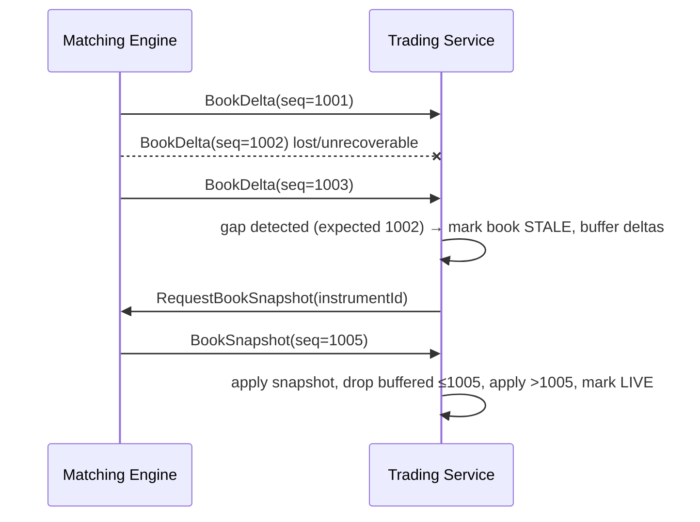

# 3. Messaging & Protocol

## 3.1 Aeron stream and channel plan

| Stream | Name | Producer → Consumers | Same host | Across hosts |
|---|---|---|---|---|
| **1001** | Commands | Trading Service, Funding, Admin → Engine primary | `aeron:ipc` | `aeron:udp?endpoint=core-a:40101` (unicast; after failover the clients switch to `core-b`) |
| **2001** | Exec events (private) | Engine → Trading Services, Funding, History | `aeron:ipc` | `aeron:udp?control=core-a:40201\|control-mode=dynamic` (**MDC**: each subscriber registers, the engine sends once) |
| **3001** | Market data | Engine → Trading Services, History | `aeron:ipc` | UDP **multicast** `aeron:udp?endpoint=239.10.1.1:40301\|interface=…` or MDC where multicast is unavailable (cloud) |
| **100** | Command journal | Engine → local Archive (recorded) | `aeron:ipc` | — |
| **101** | Replication | Primary → Standby | — | `aeron:udp?endpoint=core-b:40111` (unicast, dedicated NIC/VLAN) |
| **102** | Replication ack + heartbeat + checksum | Standby → Primary | — | `aeron:udp?endpoint=core-a:40112` |
| **4001** | Archive replay | Archive → History / recovering Trading Service / re-joining standby | `aeron:ipc` | `aeron:udp?endpoint=<consumer>:40401` (per replay session) |
| 9001 | Arbiter heartbeats / role commands | Arbiter ↔ engines | — | unicast UDP |

Every message on 2001 and 3001 carries `engineSeq` and `epoch`. Every message on 3001 also carries the per-instrument `bookSeq`.

Notes:

- **Reliable UDP**: Aeron NAK-based retransmission. For MDC and multicast, use `min` flow control with tagged receivers so the engine is never slowed by one slow subscriber. A lagging receiver is dropped, detects the gap and resyncs (snapshot for 3001, replay 4001 or `RequestUserState` for 2001).
- **Term lengths**: 64 MB on 3001; 16 MB on 1001, 2001 and 101. MTU 1408 (jumbo frames optional on the core link).
- **Publication API**: `tryClaim` for messages under MTU (zero copy), `offer` otherwise. Back-pressure is absorbed only by the publisher stage, never by the matcher.

## 3.2 Message envelope (SBE)

Every message: SBE `messageHeader` (blockLength, templateId, schemaId, version) + common fields:

| Field | Type | Notes |
|---|---|---|
| `correlationId` | int64 | set by sender, echoed in responses |
| `ingressTimestampNs` | int64 | latency tracing |
| `engineSeq` | int64 | outbound only; monotonic, gap detection & idempotent replay |
| `engineTime` | int64 | outbound only; primary clock captured at sequencing (journaled → deterministic) |
| `epoch` | int32 | outbound only; HA fencing epoch |

Schema versioning: additive fields only within a major schema version; `sinceVersion` attributes; consumers ignore unknown templates.

## 3.3 Inbound commands (stream 1001 → Matching Engine)

| Template (templateId) | Key fields |
|---|---|
| `NewOrder` (1) | userId, clientOrderId, instrumentId, side, orderType, timeInForce, price, quantity, quoteQuantity (market buy by amount), flags (postOnly, stpMode), expireTime (GTD, reserved) |
| `CancelOrder` (2) | userId, instrumentId, orderId \| clientOrderId |
| `CancelAll` (3) | userId, instrumentId (0 = all) |
| `Deposit` (10) | userId, currencyId, amount, fundingTxId |
| `WithdrawRequest` (11) / `WithdrawResult` (12) | userId, currencyId, amount, fundingTxId, outcome |
| `RequestUserState` (20) | userId |
| `RequestBookSnapshot` (21) | instrumentId, depth |
| Admin: `AddInstrument` (30), `SetInstrumentStatus` (31), `AddUser` (32), `SetUserStatus` (33) | — |

## 3.4 Outbound events (Matching Engine → 2001 / 3001)

| Template (templateId) | Stream | Key fields |
|---|---|---|
| `OrderAccepted` (101) | 2001 | orderId, clientOrderId, userId, instrumentId, side, type, tif, price, qty, status |
| `OrderRejected` (102) | 2001 | clientOrderId, rejectReason (enum: INSUFFICIENT_FUNDS, INVALID_PRICE, INVALID_QTY, BELOW_MIN_NOTIONAL, INSTRUMENT_HALTED, DUPLICATE_CLORDID, WOULD_TAKE, FOK_NOT_FILLED, OUTSIDE_PRICE_BAND, USER_SUSPENDED, UNKNOWN_ORDER) |
| `ExecutionReport` (103) | 2001 (to both maker & taker) | orderId, tradeId, userId, side, liquidity (MAKER/TAKER), lastPrice, lastQty, cumQty, leavesQty, avgPrice, fee, feeCcy, orderStatus |
| `OrderCancelled` (104) | 2001 | orderId, reason (USER, IOC_REMAINDER, STP, MARKET_NO_LIQUIDITY, ADMIN), leavesQty |
| `CancelRejected` (105) | 2001 | orderId, reason |
| `BalanceUpdate` (110) | 2001 | userId, currencyId, available, held, reason, refId |
| `UserState` (120) | 2001 | repeating groups: balances, open orders |
| `BookDelta` (201) | 3001 | instrumentId, bookSequence, repeating group {side, price, totalQty (0 = remove level), orderCount} |
| `PublicTrade` (202) | 3001 | instrumentId, tradeId, price, qty, aggressorSide, time |
| `BookSnapshot` (203) | 3001 | instrumentId, bookSequence, depth, bids[], asks[] |
| `InstrumentStatus` (204) | 3001 | instrumentId, status |
| `DepositCredited` (111) | 2001 | userId, currencyId, amount, fundingTxId |
| `Role` (130) | 2001, 3001 | role, epoch, primary endpoint |
| `Heartbeat` (250) | 2001, 3001 | engineSeq (lets consumers detect silence/gaps) |

## 3.5 Sequencing and gap recovery

- Aeron reliable UDP already retransmits; application-level gaps only occur after a slow-consumer disconnect or restart.
- Private-event (2001) gaps are recovered by Archive replay (4001) from the last `engineSeq`, or by `RequestUserState`.

## 3.6 Browser protocol (Trading Service ↔ Web) — summary

Detailed in [Trading Service §4.5](04-trading-service.md#45-websocket-api). JSON over WSS v1; decimals sent as **strings** to avoid float rounding.
