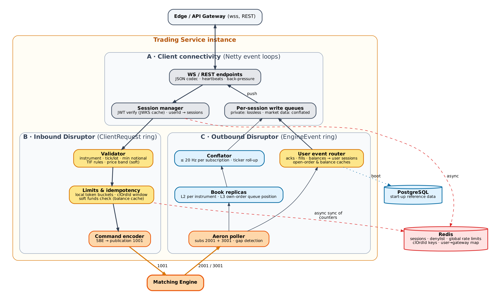

# 4. Trading Service

The bridge between the web platform and the Matching Engine.

## 4.1 Internal design



| Layer | Components | Threads |
|---|---|---|
| **A · Client connectivity** | WS/REST endpoints (JSON codec, heartbeats, back-pressure), session manager (JWT verify with cached JWKS, `userId → sessions`), per-session write queues | Netty boss + worker event loops |
| **B · Inbound Disruptor** | Validator → limits & idempotency (local token buckets, clOrdId window, soft funds check) → command encoder (SBE → 1001) | 1 handler chain, pinned |
| **C · Outbound Disruptor** | Aeron poller (2001 + 3001, gap and epoch checks) → user event router (acks, fills, balances; open-order and balance caches) ‖ book replicas (L2, own-order queue position) → conflator | 1 poller + 1 chain, pinned |
| **Side stores** | Redis (sessions, denylist, global rate limits, clOrdId keys, user→gateway map), accessed **asynchronously** and never awaited on the order path; PostgreSQL read once at boot for reference data | — |

Threads: Netty boss/worker group (I/O), 1 inbound Disruptor handler chain, 1 Aeron poller (busy-spin/backoff), 1 outbound chain (router + books), conflator timer on the event loop. Per-session write queues are bounded; a client that cannot keep up gets dropped market-data frames (conflation), never dropped private events — if the private queue overflows the session is closed and must resync.

## 4.2 Validation (before the engine)

| Check | Reject code |
|---|---|
| JWT valid, user active, KYC tier allows trading | `UNAUTHORIZED` / `FORBIDDEN` |
| Instrument exists & `TRADING` | `INSTRUMENT_UNAVAILABLE` |
| Price multiple of tick, qty multiple of lot, min/max qty, min notional | `INVALID_PRICE` / `INVALID_QTY` / `BELOW_MIN_NOTIONAL` |
| Type/TIF combo legal (MARKET ⇒ IOC; GTC default if absent) | `INVALID_TIF` |
| Price within band of last reference price (soft) | `OUTSIDE_PRICE_BAND` |
| `clientOrderId` not seen in last 24h for user (local LRU + Redis `SETNX clord:{user}:{id}`) | `DUPLICATE_CLORDID` (returns original status) |
| Rate limit (e.g. 50 orders/s, 500 open orders per user/instrument; local bucket, globally reconciled via Redis) | `RATE_LIMITED` |
| Soft funds check using cached balances | `INSUFFICIENT_FUNDS` (engine re-checks authoritatively) |

Static validation is repeated cheaply in the engine for defence in depth, but the engine's authoritative checks are funds, duplicate orderId and instrument status.

## 4.3 Routing of engine events

- Every Trading Service instance publishes commands on **1001**, stamped with its `gatewayId`, and subscribes to **2001** (MDC). The engine sends each private event once, and every gateway receives it.
- The user event router keeps only events for users with a session on this instance. This also covers maker fills for users connected elsewhere. At larger scale, 2001 can be partitioned into N streams by `userId % N` and users pinned to gateway groups by consistent hashing at the Edge.
- Router keeps `userId → Set<Session>` (multiple tabs/devices) and pushes `order`, `fill`, `balance` messages to all of them.

## 4.4 Market-data fan-out

- Maintains a full L2 replica per instrument from `BookSnapshot` + `BookDelta`.
- On client subscribe: send snapshot (top N levels, default 50, or full) with `seq`, then deltas.
- Conflation: per subscription, coalesce changed levels within a 50 ms window and send one `book.delta` with the latest totals per level → bounded bandwidth, browser never sees an inconsistent level.
- **Own-order highlight**: client marks levels where it has open orders (from the private order feed). Optionally the server adds `queueAhead` per own order (sum of qty ahead in FIFO), derived from an L3 view the engine provides only to the Trading Service (not exposed publicly).
- Public trades and 24h ticker (open/high/low/last/volume, rolled by the service) streamed on `trades.<sym>` and `ticker.<sym>`.

## 4.5 WebSocket API

Endpoint `wss://api.flash.exchange/ws` — auth via short-lived JWT in first `auth` message (not in URL).

Client → server

```json
{"op":"auth","token":"<jwt>"}
{"op":"subscribe","channels":["book.EURUSD:50","trades.EURUSD","ticker.*","orders","fills","balances"]}
{"op":"unsubscribe","channels":["book.EURUSD"]}
{"op":"order.new","reqId":17,"clOrdId":"c-8f2a","symbol":"EURUSD","side":"BUY","type":"LIMIT","tif":"GTC","price":"1.08345","qty":"10000.00","postOnly":false}
{"op":"order.new","reqId":18,"clOrdId":"c-8f2b","symbol":"EURUSD","side":"BUY","type":"MARKET","quoteQty":"5000.00"}
{"op":"order.cancel","reqId":19,"orderId":"700013"}
{"op":"order.cancelAll","reqId":20,"symbol":"EURUSD"}
{"op":"ping"}
```

Server → client

```json
{"ch":"book.EURUSD","type":"snapshot","seq":88112,"bids":[["1.08340","250000.00",4]],"asks":[["1.08350","120000.00",2]]}
{"ch":"book.EURUSD","type":"delta","seq":88113,"bids":[["1.08340","150000.00",3]],"asks":[]}
{"ch":"trades.EURUSD","data":[{"id":"55021","px":"1.08350","qty":"5000.00","side":"BUY","ts":1793750400123}]}
{"ch":"orders","data":{"orderId":"700013","clOrdId":"c-8f2a","status":"NEW","px":"1.08345","qty":"10000.00","filled":"0","avgPx":null,"tif":"GTC","ts":...}}
{"ch":"fills","data":{"tradeId":"55022","orderId":"700013","px":"1.08345","qty":"4000.00","liq":"MAKER","fee":"0.43","feeCcy":"USD"}}
{"ch":"balances","data":[{"ccy":"USD","available":"9567.20","held":"6500.18"}]}
{"op":"ack","reqId":17,"ok":true}
{"op":"ack","reqId":18,"ok":false,"code":"INSUFFICIENT_FUNDS","msg":"..."}
```

Delta semantics: `[price, totalQty, orderCount]`; `totalQty == "0"` removes the level. A client seeing `seq` ≠ last+1 re-subscribes.

REST (same service, for clients that prefer it): `POST /api/v1/orders`, `DELETE /api/v1/orders/{id}`, `DELETE /api/v1/orders?symbol=`, `GET /api/v1/orders/open`, `GET /api/v1/balances`. History endpoints live in the History Service.

## 4.6 Resilience

- On start: load reference data from PostgreSQL, subscribe to 2001/3001, request book snapshots, and send `RequestUserState` for each user as they connect. Then go live.
- Engine failover: on `Role(PRIMARY, epoch+1)` the encoder switches the 1001 destination to the new primary. Commands with no ack for 250 ms are resent with the same `clientOrderId`, and the engine deduplicates them. Events with an old epoch are discarded.
- Redis outage: falls back to local rate limits and a local idempotency cache, and trading continues (see [§1.5](01-architecture.md#15-redis-usage-kept-off-the-hot-path)).
- Optional **cancel-on-disconnect** flag per session (off by default for web users).
