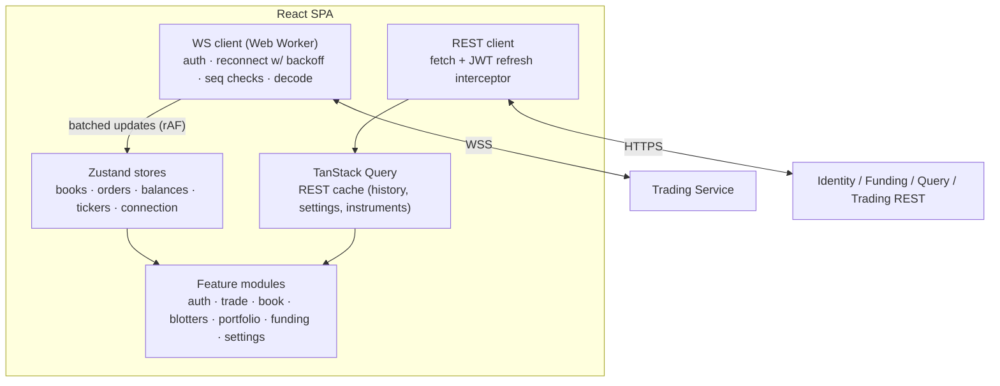
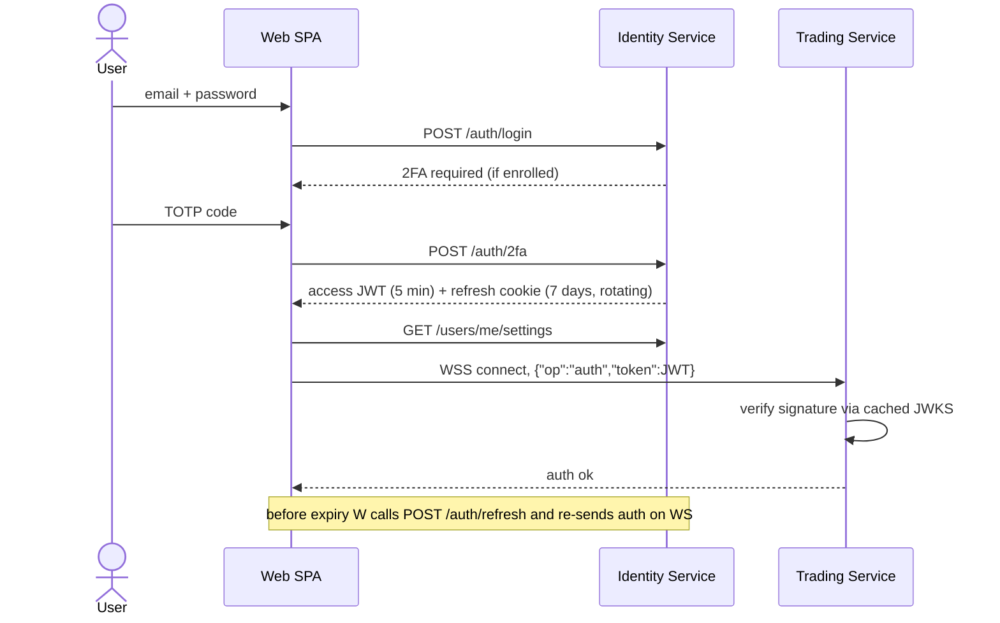

# 5. Web Trading Platform

## 5.1 Feature list

| Area | Features |
|---|---|
| **Onboarding** | Register (email, password, country, T&C), email verification, login, 2FA (TOTP) enrolment, forgot/reset password, logout, active sessions/devices list |
| **Settings** | Theme: Light / Dark / System; colour scheme (accent palette; "green-up/red-down" or "red-up/green-down" for regional convention; colour-blind safe palette); default instrument; default order type & TIF (GTC preselected); order confirmation dialog on/off; number/date format; notification preferences; 2FA; change password |
| **Funding** | Deposit fiat (choose currency, amount, method → PSP redirect / bank transfer reference), deposit history with status, (phase 6) withdrawals to verified bank account |
| **Market** | Instrument selector with search & favourites; 24h ticker (last, change %, high, low, volume); price chart (candles 1m–1D, volume) |
| **Order entry** | Buy/Sell tabs; Limit / Market; TIF dropdown (GTC preselected, IOC, FOK); price, quantity, total (two-way calculated); % of available buttons (25/50/75/100); post-only checkbox; estimated fee; available balance; client-side validation (tick/lot/min notional); click on a book level fills price; keyboard shortcuts; confirmation dialog (optional) |
| **Order book** | Bid and ask side by side (or stacked on mobile), price-time priority order, per-level total quantity, order count, cumulative depth bar; spread & mid; precision grouping (e.g. 0.00001 / 0.0001 / 0.001); flash on change; **user's own levels highlighted** with marker + own qty and (optional) queue position tooltip |
| **Recent trades** | Public tape with aggressor colouring |
| **Open orders blotter** | Live: time, symbol, side, type, TIF, price, qty, filled, remaining, avg price, status (NEW / PARTIALLY_FILLED), cancel button, cancel-all; progress bar for partial fills |
| **Order history** | Filled / cancelled / rejected orders, filterable, CSV export |
| **Trades blotter** | User's fills: time, symbol, side, price, qty, notional, fee, maker/taker; filters, CSV export |
| **Portfolio** | All assets: available, in orders (held), total, valuation in reporting currency (USD/EUR/GBP selectable), allocation chart, P&L (realised, phase 6) |
| **Notifications** | Toasts for ack/reject/fill/cancel; optional sound; connection status indicator (live / reconnecting / stale) |

## 5.2 Layout (desktop)

```
┌───────────────────────────────────────────────────────────────────────────┐
│ Logo │ EUR/USD ▾ 1.08345 +0.12% H 1.0851 L 1.0812 Vol 1.2B │ Deposit │ ⚙ │ 👤│
├───────────────────────────────┬───────────────────────┬───────────────────┤
│                               │ ORDER BOOK            │ ORDER ENTRY       │
│        PRICE CHART            │  Bids     │   Asks    │ [Buy] [Sell]      │
│                               │ qty  px   │ px   qty  │ Limit | Market    │
│                               │ ...  ▶own │ ...       │ Price  Qty  Total │
│                               │ spread 0.00010        │ TIF [GTC ▾]       │
├───────────────────────────────┼───────────────────────┤ [ Place order ]   │
│ Open orders | Order history | Trades | Portfolio       │ Balances          │
│ (virtualised live blotters)                            │ Recent trades     │
└───────────────────────────────────────────────────────────────────────────┘
```

Responsive: ≥1280 px full grid (panels resizable, layout persisted in settings); 768–1279 px two columns; < 768 px tabbed (Chart / Book / Trade / Orders) with bottom sheet order entry.

## 5.3 Front-end architecture



- WebSocket decoding and book maintenance run in a **Web Worker**; UI receives batched state at `requestAnimationFrame` cadence → smooth at high update rates.
- Decimal arithmetic via `decimal.js`/`big.js` (never JS floats for money).
- Blotters virtualised (react-virtuoso / TanStack Table).
- Theming via CSS custom properties + Tailwind `dark:`; settings loaded at login and cached in `localStorage` to avoid flash of wrong theme.
- Accessibility: WCAG 2.1 AA, keyboard navigation, colour-blind palette.
- Security: access token in memory, refresh token in `HttpOnly; Secure; SameSite=Strict` cookie, CSP, no third-party scripts on trading pages.

## 5.4 Auth flow


