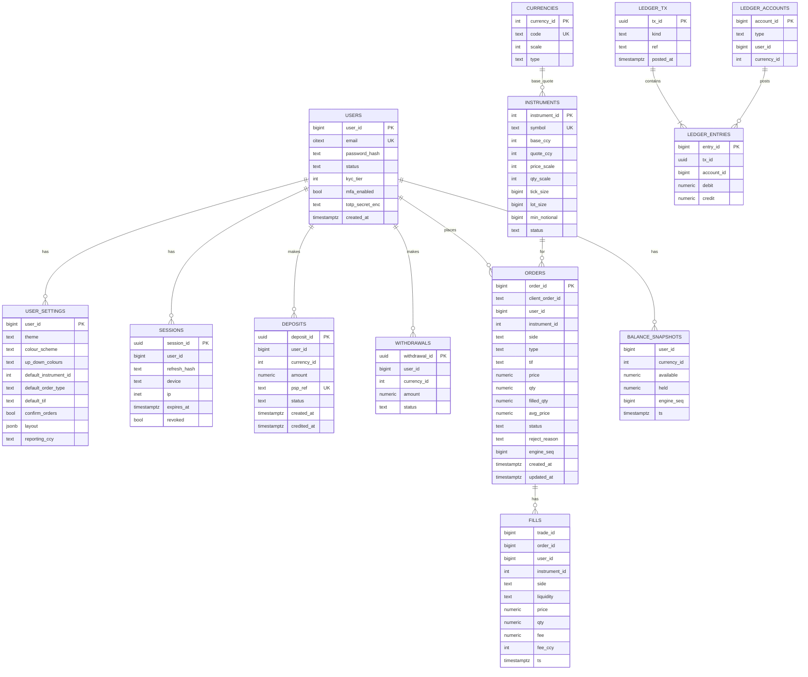
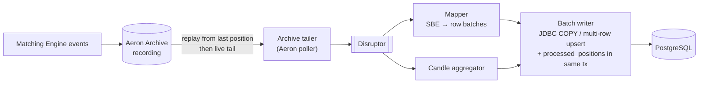

# 6. Accounts, Funding & Data

## 6.1 Balance ownership

| Balance view | Owner | Purpose |
|---|---|---|
| Trading balance (`available`, `held`) | **Matching Engine** (authoritative) | Funds holds and settlement on the hot path |
| Ledger (double-entry journal) | **Funding Service** / PostgreSQL | Money in/out of the platform, regulatory record |
| Balance history / portfolio | **History Service** / PostgreSQL | Projection of engine `BalanceUpdate` events for UI |

A nightly + continuous **reconciliation job** checks: ledger customer liability per currency == Σ engine balances (from latest snapshot / projection). Breaks raise alerts and can freeze affected accounts.

## 6.2 Deposit flow (summary — full sequence in [07](07-interactions.md#73-deposit))

1. User initiates deposit → Funding creates `deposit(PENDING)` and PSP payment intent.
2. PSP confirms (webhook, signature verified, idempotent on PSP reference).
3. Funding posts ledger entries `DR bank_clearing / CR customer_liability:<user>` and status `CONFIRMED`.
4. Funding sends `Deposit` command (fundingTxId = idempotency key) to the Matching Engine.
5. Engine credits `available`, emits `BalanceUpdate` → Funding marks `CREDITED`; Trading Service pushes balance to the user.

Phase 1 ships a **Mock PSP** (simulated bank with instant/delayed/failed outcomes) behind a `PaymentProvider` interface.

## 6.3 Fees

Maker/taker fee schedule per instrument and user tier (default maker 0.05%, taker 0.10%, configurable). Fees charged in the currency received, accrued to a platform fee account inside the engine, reported in `ExecutionReport`.

## 6.4 PostgreSQL schema (main tables)

Additional: `candles(instrument_id, interval, open_time, o,h,l,c, volume)` (TimescaleDB hypertable optional), `audit_log`, `processed_positions(consumer, archive_position, engine_seq)` for exactly-once projection, `api_keys` (phase 6).

Indexes: `orders(user_id, status, created_at desc)`, `fills(user_id, ts desc)`, `fills(instrument_id, ts)`. Partition `orders`/`fills` monthly.

## 6.5 Persistence pipeline

Exactly-once effect: rows and the consumer's `engine_seq` are committed in one transaction; on restart replay resumes from the stored archive position and skips `engine_seq ≤ stored`.

## 6.6 History Service REST

`GET /api/v1/orders?status=&symbol=&from=&to=&cursor=` · `GET /api/v1/fills?...` · `GET /api/v1/portfolio` (balances + valuation from latest mid prices) · `GET /api/v1/candles?symbol=&interval=&from=&to=` · `GET /api/v1/instruments` · `GET /api/v1/export/{orders|fills}.csv`. Cursor-based pagination.

## 6.7 Redis data model

See [§1.5](01-architecture.md#15-redis-usage-kept-off-the-hot-path) for the key spaces. Deployment: Redis 7 primary + replica with Sentinel (3 sentinels), AOF `everysec`. All keys have TTLs, and **no key holds data that can't be rebuilt**. Losing Redis degrades rate limiting and idempotency to per-instance and forces users to log in again, but never affects balances, orders or trades.
