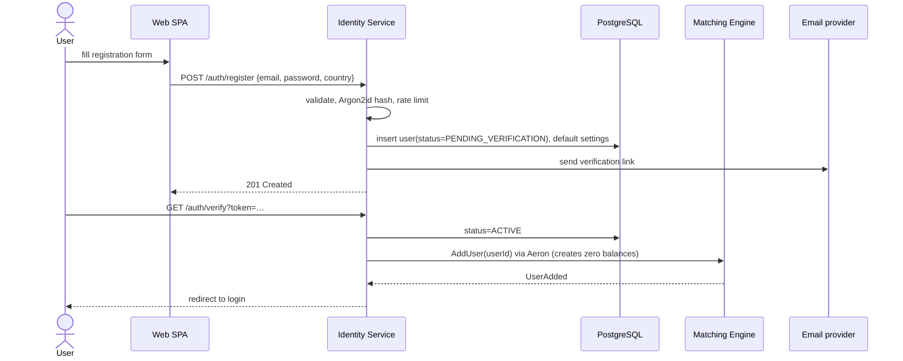
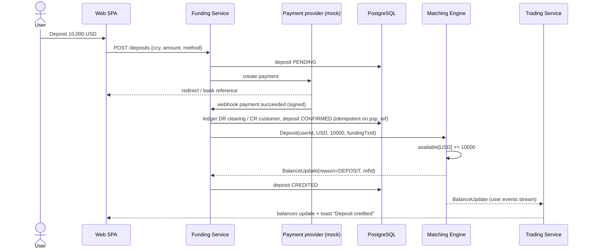
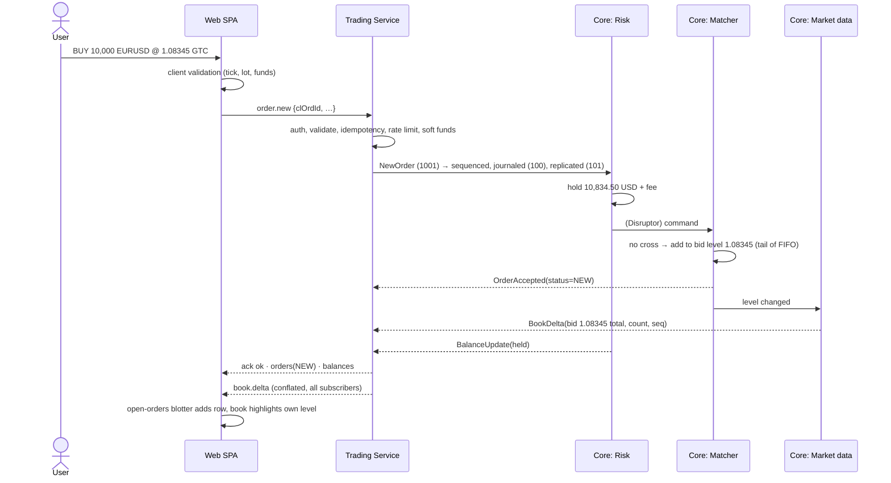
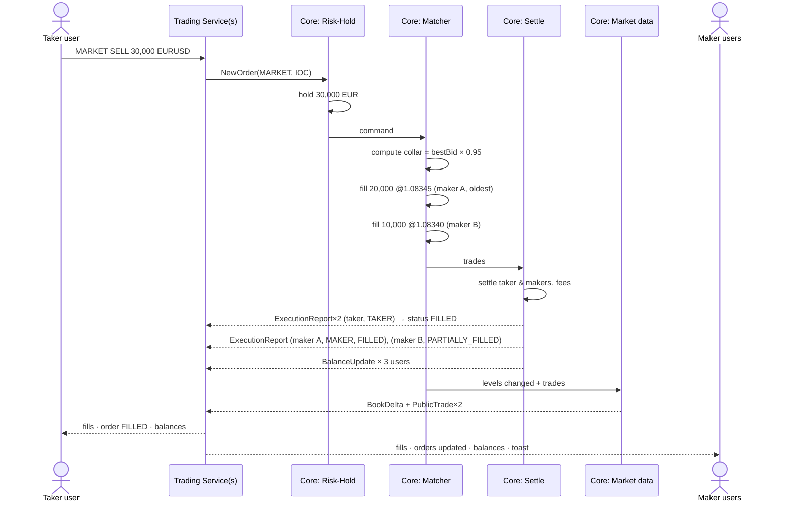
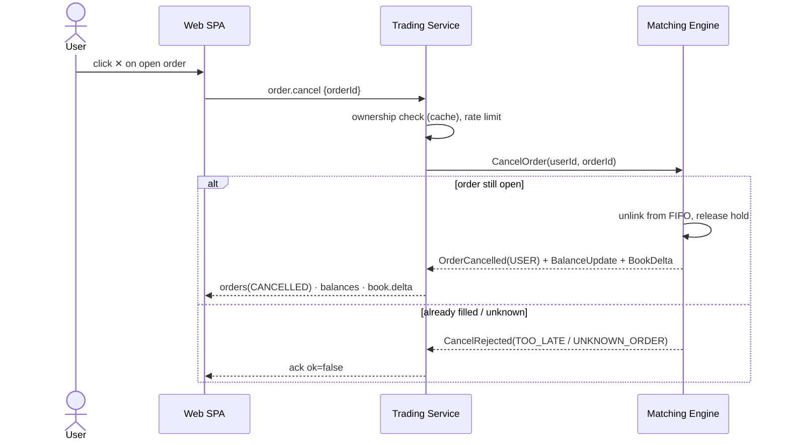
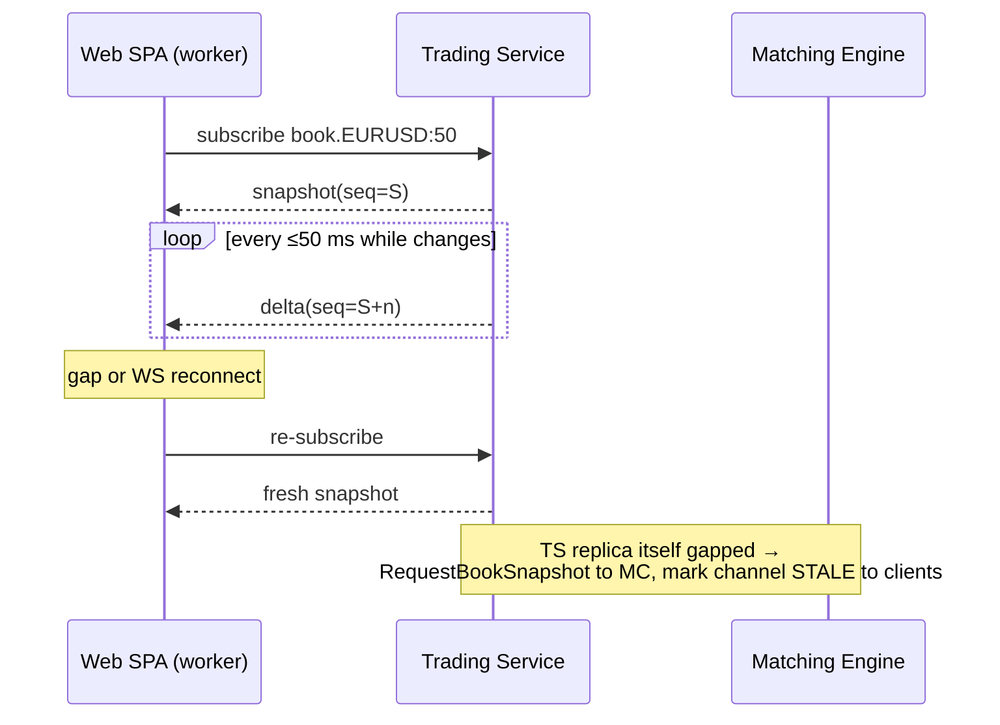
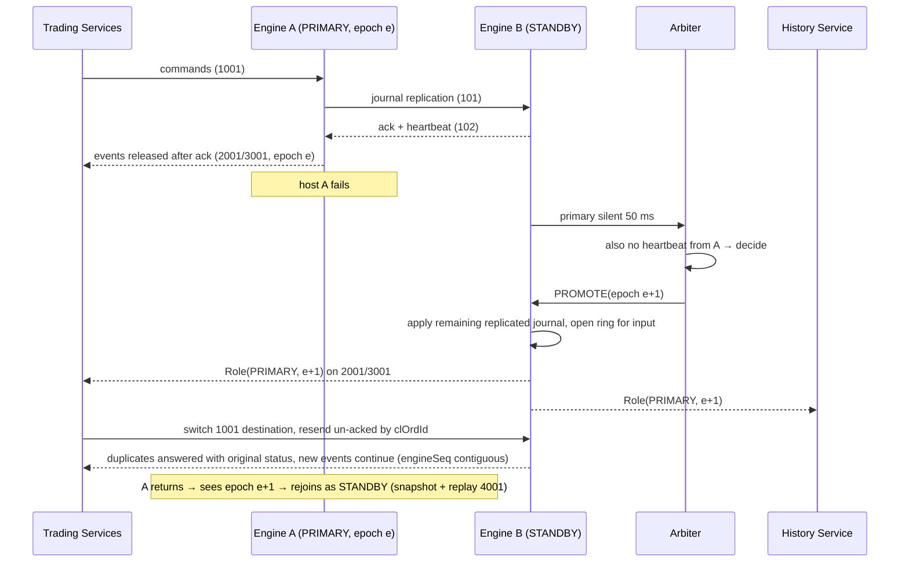
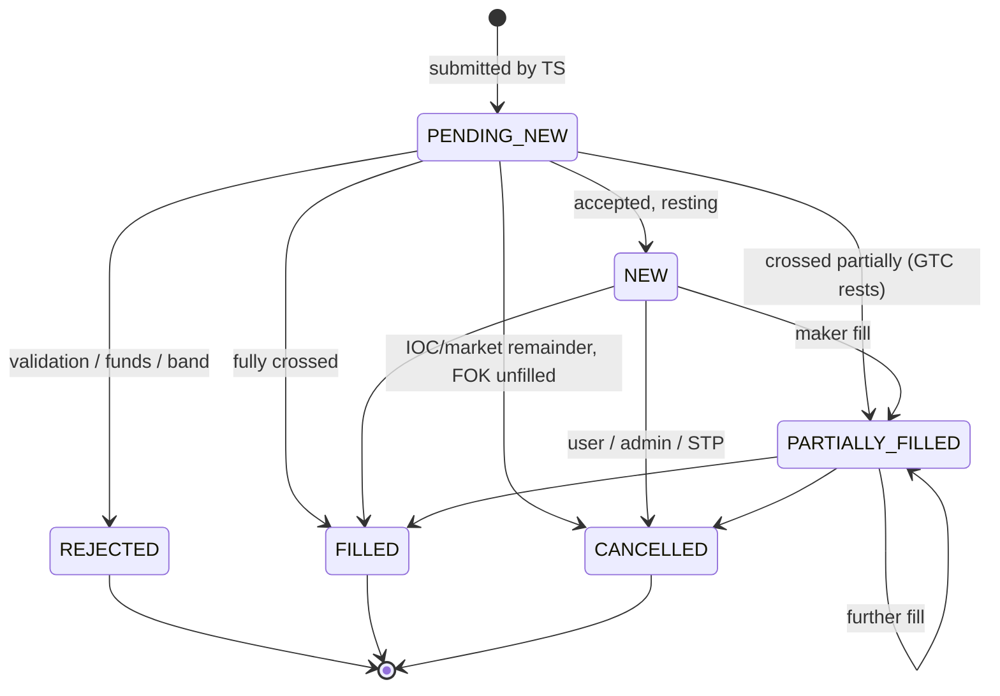

# 7. Interactions

## 7.1 Registration

## 7.2 Login → live session

See [Web Platform §5.4](05-web-platform.md#54-auth-flow). After WS auth, the Trading Service sends `RequestUserState` if the user's state is not cached, then pushes `balances` and `orders` snapshots followed by live updates.

## 7.3 Deposit

## 7.4 Place limit order (rests on book)

## 7.5 Market order matched against several makers

If liquidity runs out or the collar is reached, the remainder is cancelled: `OrderCancelled(reason=MARKET_NO_LIQUIDITY)` and the unused hold released.

## 7.6 Cancel order

## 7.7 Order book subscription & resync

## 7.8 Engine failover (primary → standby)

## 7.9 Order state machine

`PENDING_NEW` exists only in the Trading Service / UI (between submit and engine response); the engine itself emits only final-of-command states.
