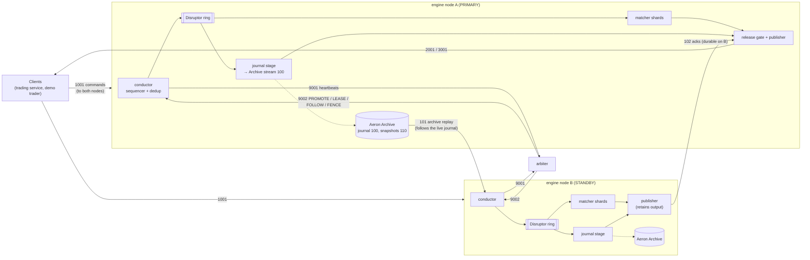

# 10. Engine durability and high availability (implemented, roadmap phase 2)

This chapter describes what is built in `matching-engine` for durability and HA. It refines the plan in
[§2.8–2.9](02-matching-engine.md) where the implementation made different choices (called out as ADRs below).

## 10.1 Overview

| Concern | Mechanism |
|---|---|
| Nothing acknowledged is lost on a crash | Every `NewOrder`/`CancelOrder` is written to the **journal** (Aeron Archive recording of IPC stream 100) by a Disruptor stage parallel to the matchers. The **release gate** holds a command's output until the archive has recorded its journal entry. |
| Fast restart | **State snapshots** (stream 110, one recording per snapshot) of the sequencer, dedup window and every book. Recovery = latest valid snapshot + replay of the journal after it. |
| Determinism | The conductor stamps sequence, timestamp, order id and the duplicate flag into the journal entry; matching never reads clocks. Replay reproduces byte-identical state (tested). |
| Host failure | A **standby** follows the primary's journal, re-journals it locally and acknowledges. In SYNC mode output is released only after the standby's ack (RPO 0). |
| Split brain | An **arbiter** grants the primary a **lease**; without it the primary stops taking commands and withholds unacknowledged output. The standby is promoted only after the lease expired. Each promotion increments the **epoch**; stale primaries are **fenced**. |
| Exactly-once for clients | Output is **at-least-once** after recovery/failover; `EngineClient` drops what it has already seen using engine sequence + an `EngineRole` epoch announcement. Commands are resent by `clientOrderId`; the engine rejects duplicates. |

## 10.2 Sequencing and the journal

- The **conductor** (`node/EngineConductor`) is the single producer of the ring. For each command it takes
  `engineSequence = sequencer.next()`, assigns `orderId = engineSequence + 1`, stamps the engine timestamp and the
  epoch, and checks `(userId, clientOrderId)` against the **dedup window** (`ha/DedupWindow`, bounded FIFO, default
  65 536 entries, `flash.engine.dedup.window`; `clientOrderId = 0` is never deduplicated).
- A duplicate new order still consumes a sequence and is journaled with `FLAG_DUPLICATE`; the matcher answers
  `REJECTED / DUPLICATE_CLIENT_ORDER_ID`. Replay therefore reproduces the same reject.
- Book-snapshot requests, state snapshots and role changes travel through the ring for ordering but are **not
  journaled** and do not consume a sequence (they reuse the last one), so replay is not affected by them.
- `JournalEntry` (template 50, 88-byte block): every field of the command as processed, plus `epoch` and
  `releasedSequence` (what the writer had released when it journaled the entry; the standby uses it to bound the
  output it keeps).
- The journal is one recording per node that is **extended** on every restart (`extendRecording` with the
  publication's initial position set to the recording's stop position), so positions are continuous. The archive
  repairs the stop position of a recording interrupted by a crash when it starts.

### Release gate (`durability/DurabilityController`, `ha/ReplicationLink`)

For each journaled command, on the publisher thread, in sequence order:

1. wait until the archive's recording position ≥ the entry's journal position (local durability);
2. HA primary in SYNC mode with a standby attached: wait until the standby's ack ≥ the sequence;
3. if the ack does not arrive within `ha.ackTimeoutMs`, **degrade** to ASYNC (counted, shown on `/status`) and
   resume SYNC as soon as the standby has caught up;
4. releasing without an ack (ASYNC, degraded, or no standby) requires a **valid lease**; a node without a lease
   waits, a fenced node drops the output.

## 10.3 Snapshots and cold recovery

- The conductor schedules a snapshot every `snapshot.state.intervalMs` or every
  `snapshot.state.intervalCommands` sequenced commands, after a promotion, after bootstrapping a standby and at
  orderly shutdown. A snapshot slot flows through the ring: the conductor writes section 0 (sequencer + dedup
  window), each matcher writes its shard (books with resting orders in priority order, `bookSequence`,
  `tradeSequence`), the journal stage records the journal position, and the publisher writes the recording:
  `SnapshotBegin`, `SnapshotChunk`s (≤ 32 KiB each), `SnapshotEnd` with a CRC32 of all payload bytes.
- The newest `snapshot.state.retained` (default 3) snapshots are kept; older ones are purged.
- **Recovery**: open (extend) the journal, find the newest snapshot whose checksum and length verify (incomplete
  or corrupt snapshots are skipped), restore it into the sequencer and the matchers before the consumer threads
  start, announce the new epoch (`EngineRole`), then replay the journal from the snapshot's position to the end.
- The shard count is part of the snapshot layout: restoring with a different `matcherShards` is refused.
- Standalone nodes increment their epoch (`<data.dir>/node-epoch`) on every start, so clients de-duplicate the
  output re-published by the replay.

## 10.4 Replication, failover and fencing

| Role | Behaviour |
|---|---|
| `PENDING` | Started with HA enabled, waits for the arbiter. Commands are drained and discarded. |
| `PRIMARY` | Recovered from its own snapshot + journal. Accepts commands while the lease is valid, gates output as above. |
| `STANDBY` | Bootstrapped from the primary's newest snapshot (remote archive replay), purged its own archive, took a local snapshot, then follows the primary's journal through a **remote archive replay that tails the live recording** (stream 101), applies entries with their original sequence, journals them locally and acks (stream 102) once durable. Output is computed but **retained**. |
| `FENCED` | Another node owns the epoch. Output is dropped, the process exits with status 3 and is restarted by its supervisor; it comes back `PENDING` and follows. |

**Promotion of the standby**: it drains what it has received, announces `EngineRole(PRIMARY, epoch)` on both
output streams, re-publishes its retained output (the last `RETAIN_WINDOW` = 16 384 sequences beyond what the old
primary reported as released, because "released" means handed to the old primary's media driver, not delivered),
takes a snapshot and starts accepting commands.

**Arbiter rules** (`ha/Arbiter`):

1. no primary yet: promote the preferred node (first in `flash.arbiter.nodes`), or after `startupGraceMs` the first
   pending node;
2. primary alive: renew its lease every third of `leaseDurationMs`; tell pending nodes and standbys that lost the
   replication stream to `FOLLOW`; `FENCE` any other node claiming to be primary; a primary that restarted is
   promoted again under a new epoch;
3. primary silent for `primaryTimeoutMs` **and** `leaseDurationMs + leaseGuardMs` since the last grant: promote the
   standby if it is caught up and has handled at least the sequence the old primary last reported as released;
   otherwise wait (and say so on `/status`).

With the defaults (lease 300 ms, guard 100 ms, timeout 250 ms, heartbeats every 50 ms) the standby is promoted
about 350–450 ms after the primary dies: 325 ms measured with `docker kill -s KILL` in the compose HA profile, and
about 550 ms in `HighAvailabilityIT` with 300 ms leases.

**Planned switchover**: stop the arbiter, set `primary=<standby id>` and a higher `epoch` in its state file, start
it. It fences the current primary and promotes the standby once the old lease has run out (this is what
`plannedSwitchoverFencesTheOldPrimaryWhichRejoinsAsStandby` tests).

### Client side (`client/EngineClient`, `client/OutputDeduplicator`)

- Commands go to **every** engine through one multi-destination publication (`control-mode=manual`); only the
  primary acts on them.
- Output from every engine is received; messages from an engine whose announced epoch is older than the newest are
  dropped as stale.
- Every output message carries its command's engine sequence in the first 8 bytes of its body. After an
  `EngineRole` with a newer epoch the deduplicator drops messages with a lower sequence and, for the last sequence
  it had seen, exactly as many messages as it had already received. Book snapshots are always delivered.
- Resend: a client resends orders that have no response after a failover with the same `clientOrderId`. If the
  new primary already has the original it rejects the resend with `DUPLICATE_CLIENT_ORDER_ID` and the original's
  re-published output arrives anyway. (`HighAvailabilityIT` does this; the trading service will own it in phase 7.)

## 10.5 Decisions (ADRs)

| # | Decision | Alternatives | Why |
|---|---|---|---|
| 10-1 | Primary/standby with an external arbiter and leases | Aeron Cluster (Raft, 3 nodes) | Keeps the existing Disruptor pipeline and two-node footprint; the arbiter is tiny and stateless apart from epoch/primary. Aeron Cluster remains the upgrade path if three engine nodes become acceptable. |
| 10-2 | Standby follows by **remote archive replay of the live journal** | Separate MDC replication publication + `ReplayMerge` | One stream (the journal) is the replication stream, so gap repair is just "replay from my last position". Costs ~1 archive hop of latency on the SYNC path; a direct live path is an optimisation for phase 12. |
| 10-3 | Journal entries are written by a Disruptor stage **parallel** to the matchers; the gate is in the publisher | Journal before the ring (in the conductor) | Journaling overlaps with matching; the conductor never blocks on disk or replication. |
| 10-4 | At-least-once output + client de-duplication by (sequence, count) | Exactly-once via transactional output log | Deterministic output makes the counting rule exact and cheap; no extra persistence. |
| 10-5 | Duplicate detection in the sequencer, journaled as a flag | Detection in the matcher | The decision is made once, journaled, and replayed identically on the standby. |
| 10-6 | Lease checked by the primary itself (stop ingress, withhold unacked output) | Fencing only by the arbiter | A partitioned primary stops on its own; the arbiter's guard covers lease delivery delay. |

## 10.6 Schema versioning rules (protocol)

1. `MessageHeader.schemaId` (7001) identifies the protocol; `version` is bumped for every released change.
2. **Additive only within a schema version line**: new fields go at the end of a block, new templates get new ids.
   Decoders use the received `blockLength`, so an old decoder skips trailing fields it does not know and a new
   decoder must treat fields beyond a shorter received block as absent (default value).
3. Never reuse or renumber a template id, an enum code or a field offset; deprecated fields keep their space.
4. Enums: unknown codes decode to `null` (or a `NULL_VALUE`) and must be handled; adding codes is allowed.
5. **Journal and snapshot formats are protocol too**: a new engine version must replay journals written by the
   previous version. Snapshot sections carry their own version (`STATE_VERSION`) and the reader rejects versions it
   does not know, so an incompatible change requires the previous version to take a fresh snapshot first.
6. Consumers ignore unknown templates (`EngineEventListener.onUnknownMessage`).
7. Breaking changes need a new `schemaId` (or a major version) and a dual-publishing period.

## 10.7 Rolling upgrade procedure

1. Upgrade the **standby**: stop it, deploy the new version, start it; it bootstraps from the primary and follows.
   Wait for `/status` to show `STANDBY`, `peerVisible=true` and `lastSequence` equal to the primary's.
2. **Switch over** (§10.4 planned switchover). The old primary is fenced, exits and restarts as `PENDING`.
3. Upgrade the old primary while it is down; it rejoins as standby of the new version.
4. Roll back by the same steps in reverse. Rule 5 of §10.6 must hold in both directions for the versions involved.

## 10.8 Configuration reference

| Key (`flash.engine.`) | Default | Meaning |
|---|---|---|
| `journal.enabled` | `false` (builder), `true` in container configs | Journal + snapshots |
| `data.dir` | `data` | Archive, epoch file |
| `archive.host` / `archive.controlPort` | `localhost` / `0` | Remote archive control endpoint (required for HA) |
| `archive.fileSyncLevel` | `0` | 0 page cache, 1 fsync data, 2 fsync data + metadata |
| `journal.termLength` | 16 MiB | Term length of the journal publication |
| `snapshot.state.intervalMs` / `intervalCommands` / `retained` | 60 000 / 100 000 / 3 | Snapshot schedule and retention |
| `dedup.window` | 65 536 | Remembered `(user, clOrdId)` pairs (0 disables) |
| `ha.enabled`, `ha.nodeId`, `ha.mode` | `false`, `1`, `SYNC` | HA switch, node identity, release mode |
| `ha.self.host`, `ha.self.replicationPort` / `ackPort` / `controlPort` | `localhost`, 40111 / 40112 / 40113 | This node's endpoints |
| `ha.peer.host`, `ha.peer.archivePort` / `ackPort` | `localhost`, 8010 / 40112 | The other node |
| `ha.arbiter.host` / `port` | `localhost` / 40901 | Arbiter heartbeat endpoint |
| `ha.heartbeatIntervalMs` / `ha.ackTimeoutMs` | 50 / 200 | Heartbeats to the arbiter, SYNC ack timeout |

Arbiter (`flash.arbiter.`): `listen.host`, `listen.port`, `nodes` (`id=host:controlPort,...`), `leaseDurationMs`,
`primaryTimeoutMs`, `leaseGuardMs`, `startupGraceMs`, `state.file`, `aeron.*`, `http.*`. See
`docker/config/arbiter.properties`.

## 10.9 Tests

| Test | What it proves |
|---|---|
| `DurabilityIT` | Crash (halt) recovery replays the journal to byte-identical book state; graceful restart restores from the shutdown snapshot without replay; snapshot + journal tail; duplicate `clOrdId` rejected across restarts; corrupt/incomplete snapshots skipped; shard-count change refused; re-published output de-duplicated by the client. |
| `HighAvailabilityIT` | Exit criterion: primary killed under load, standby promoted in < 1 s, client resends, no lost or duplicated fills or reports, contiguous book updates; then the old node rejoins and a second failover works. Also ASYNC mode, standby loss with SYNC degrade, lease expiry holding commands, planned switchover with fencing, a 10 % lossy replication link, and a pending node. |
| `ArbiterTest` | Election, lease renewal, no promotion before lease + guard, no promotion of a standby that is behind or not caught up, fencing, re-follow, restarted primary, persistence, grace fallback. |
| `ReplicationLinkTest`, `OutputDeduplicatorTest`, `SequencerTest`, `DedupWindowTest`, `MatchingEngineStateTest`, `DurableCommandTest`, `RetainedOutputTest` | The building blocks. |
| `scripts/ha-failover-smoke-test.sh` | `docker kill -s KILL` of the primary container in the compose `ha` profile, promotion time, traffic continues, killed node rejoins as standby. |

## 10.10 Known limits and follow-ups

- Two engine nodes and one arbiter: the arbiter is a single point of *availability* (not of safety). If it is down
  longer than the lease, the primary stops taking commands. Run it under a supervisor; a 3-node arbiter (or Aeron
  Cluster, ADR 10-1) is a phase 12 item.
- Snapshots are written on the publisher thread, which pauses output for the time it takes to record them
  (milliseconds for current book sizes). Move to a background writer when books get large.
- `archive.fileSyncLevel=0` survives process crashes but not a host power loss; production should run SYNC
  replication across hosts or set level 1.
- The branch coverage gate is 85 % (was 90 %): some failure-handling paths need fault injection to reach.
